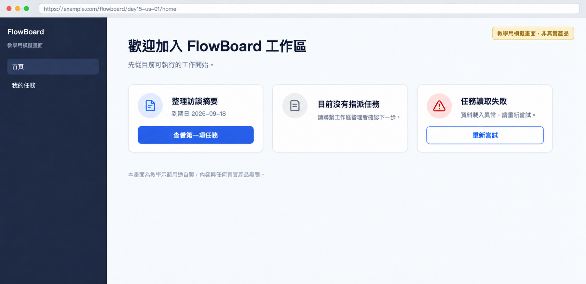

# Day 15 - 用 Claude Code 產生可互動 Demo 規格


## 體驗操作動線

在正式寫程式前，怎麼讓團隊提前摸到產品的操作動線？

這就像建築師蓋房子前，先弄出一棟能開門、會亮燈的模型屋。屋主推開門走進客廳，就能直接感受到房間的動線順不順。

可互動 Demo 規格是用文字把原型範圍、頁面狀態、測試資料與操作動線定下來的藍圖。

## 核心概念拆解


- ① 原型邊界：像遊樂園的安全護欄，圈出這次要驗證的核心功能，讓團隊把力氣花在刀口上。
    
- ② 固定測試資料：像實驗室的標準砝碼，提供穩定一致的資料，確保每個人測出來的結果都一樣。
    
- ③ 狀態轉換卡：像車站的時刻與月台看板，寫清楚每個畫面的資訊、按鈕跟下一步去哪裡。

## 做法與權衡

先確定要驗證什麼，再挑選適合的原型精細度。

- ① 靜態畫面點擊串接：簡單有效。用靜態頁面切換做出基本動線，產出速度超快，適合快速確認介面層級。
    
- ② 結構化資料互動規格：高效實用。用完整狀態表跟三組固定資料，把正常、空資料跟異常狀態一次做足，提供高擬真且能重複驗證的操作體驗。

## 執行規則

① 圈定驗證的核心假設：鎖定特定的使用者故事與關鍵操作流程。
② 建立固定測試資料集：準備好任務、空資料跟連線異常重試這三組穩定資料。 
③ 詳列頁面狀態卡片：寫下畫面名稱、內容、主要動作跟下一步。 
④ 標註待確認互動細節：沒敲定的動線統一標上標記，留給團隊一起拍板。

## 結構化示範：FlowBoard 原型狀態卡片

在 FlowBoard 教學案例中，本次 Demo 專注驗證 US-01（新成員首頁引導動線）。設定三組標準測試資料：

- 資料情境 A：有指派任務（任務名稱「整理訪談摘要」，到期日 2026-09-18）。    
- 資料情境 B：沒指派任務（可檢視的任務數量為零）。
- 資料情境 C：讀取失敗，點重試後順利載入情境 A。




依據上述資料展開四張核心狀態卡片：

① 首頁狀態卡片（情境 A：具備任務）
- 必要內容：歡迎訊息、任務名稱、預計完成到期日
- 主要行動：點選「查看第一項任務」按鈕
- 下一步畫面：任務詳情頁面
- 追溯來源：FR-01、FR-02

② 首頁狀態卡片（情境 B：待分派任務）
- 必要內容：待分派任務說明、管理者聯繫指引
- 主要行動：點選「關閉提示」
- 下一步畫面：標準工作區首頁
- 追溯來源：FR-03、決策 D-02

③ 首頁狀態卡片（情境 C：讀取異常）
- 必要內容：連線載入異常提示訊息
- 主要行動：點選「重新嘗試」按鈕
- 下一步畫面：重新載入並顯示情境 A 內容
- 追溯來源：AC-03

④ 任務詳情狀態卡片
- 必要內容：任務標題、執行狀態、到期日
- 主要行動：點選「返回」連結
- 下一步畫面：標準工作區首頁
- 追溯來源：FR-02、原型架構決策

## 讓 AI 執行 Demo 規格產出

```text
角色：你是一位專業的原型規格設計助手，專注建立清晰、可重複驗證的 Demo 規格。

輸入資料：
【貼上 PRD、功能需求 ID、驗收標準、固定測試資料與原型展示範圍】

執行步驟：
① 明確展示目標：列出本次原型要驗證的核心故事與關鍵路徑。
② 鎖定固定資料：設定三組穩定測試情境，支援一致性的驗收重現。
③ 逐頁展開狀態：為每個畫面定義必要資訊、主要行動與下一個跳轉目標，涵蓋正常、空資料與異常重試狀態。
④ 標示待確認事項：遇到需要團隊拍板的細節，標註【待確認】並提供待解問題。

輸出格式：
畫面清單／狀態卡片／互動路徑／測試資料設定／待確認問題清單
```

### 範例輸出與核心價值

有了結構化 Demo 規格，團隊在寫程式前就能對畫面跳轉與錯誤狀態有共識。這讓產品原型不再只是好看的畫布，而是能拿來驗收的實用依據。

## 人類需要檢查什麼

- ① 固定測試資料能不能順利跑出三種情境？
- ② 每個按鈕是不是都有明確的下一步？
- ③ 錯誤跟空資料畫面有沒有清楚的離開與復原管道？
- ④ 文案跟操作焦點順序是不是順手的？

## 把規則封裝成 Claude Code Skill

建立檔案路徑：

```text
.claude/skills/demo-spec/SKILL.md
```

設定 YAML 內容：

```markdown
---
name: demo-spec
description: 將已審查的 PRD 與驗收條件轉換為可互動 Demo 規格，包含頁面、狀態、動作、測試資料與明確邊界。
---

請先明確列出本次要驗證的核心假設與展示範圍。
每個頁面皆詳細記錄起始狀態、可執行動作、下一步畫面、成功狀態、空資料狀態與異常狀態。
使用固定測試資料驅動原型，確保操作結果具備穩定重現性。
標註待確認事項，保留決策空間交由產品團隊確認。
```

在 Claude Code 中執行指令：

```text
/demo-spec 請讀取 docs/prd/flowboard-onboarding.md 和驗收條件，產生 Demo 規格。
```

執行 Skill 後，Claude Code 會產出條理清晰的頁面狀態卡片與固定測試資料清單，明確規範本次展示的原型邊界。

## 今天的產出物


完成了一份包含核心範圍、固定資料、畫面狀態、互動動線與需求 ID 的 Demo 規格。當原型有了清楚的邊界，團隊就能開始做真正的動態驗證。

## 參考資料

- [Nielsen Norman Group：UX Research Methods Glossary](https://media.nngroup.com/media/articles/attachments/glossary-ux-research.pdf)
