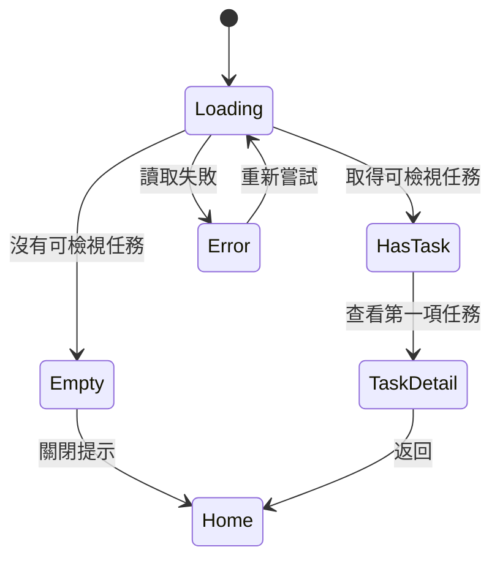

# Day 16｜從 PRD 轉成頁面流程與操作路徑


頁面清單寫了「首頁、任務詳情」，開發時仍可能卡住：錯誤後去哪裡？關閉提示後如何回來？今天把名詞組成可走完的路徑。

## 頁面清單不等於流程

PRD 描述規則，流程要描述狀態如何轉移。每一步應有起始狀態、使用者行動、系統回應、下一狀態與對應需求。若只畫 happy path，空資料與錯誤會變成臨場決定。

FlowBoard 的主要任務是「新成員找到第一項任務」，不是「看完歡迎卡」。所以路徑終點應是看見可執行的任務內容；是否完成任務屬後續產品行為。

## 可複製的轉換 Prompt

```text
請把以下 PRD、故事與驗收標準轉為操作流程，不設計新功能。

輸入：【PRD、FR、User Story、Acceptance Criteria、Demo 範圍】

任務：
1. 找出角色、入口、前置條件與成功終點。
2. 產生主要路徑、替代路徑、錯誤與復原路徑。
3. 每一步保留來源 ID；找不到來源標「無來源」。
4. 檢查每個畫面是否有出口，每個錯誤是否能復原。

輸出表格：Path ID／步驟／目前狀態／使用者動作／系統回應／
下一狀態／來源 ID／未決問題。
另輸出 Mermaid stateDiagram-v2；不要把推測寫成既定規格。
```

## FlowBoard 操作流程表

| Path | 目前狀態 | 動作 | 系統回應 | 下一狀態 | 來源 |
|---|---|---|---|---|---|
| P1 | 首次首頁、有任務 | 選「查看第一項任務」 | 開啟任務詳情 | 已找到任務 | FR-02 |
| P2 | 首次首頁、無任務 | 關閉提示 | 顯示一般首頁 | 暫時離開 | FR-03／D-02 |
| P3 | 讀取失敗 | 選「重新嘗試」 | 再次載入 | 有任務或無任務 | AC-03 |
| P4 | 任務詳情 | 返回 | 回到首頁 | 一般首頁 | Demo 決策 |



這張圖暴露一個缺口：P4 的返回行為只有 Demo 決策，PRD 沒有來源。團隊可把它補成規格，或明確聲明採既有導覽規則。追溯欄的價值，就是讓這類「看似理所當然」的決定浮出來。


## 再加一張頁面責任表

流程描述移動，頁面責任表則防止資訊散落。每個畫面只要回答它在任務中負責什麼：

| 畫面 | 使用者問題 | 必要資訊 | 主要行動 | 不負責的事 |
|---|---|---|---|---|
| 首頁提示 | 我現在先做什麼？ | 任務名稱、到期日 | 查看任務 | 編輯完整任務 |
| 任務詳情 | 這項工作要求什麼？ | 標題、狀態、內容 | 依既有流程操作 | 新手教學中心 |
| 無任務狀態 | 為何沒有下一步？ | 尚未被指派、聯絡建議 | 關閉提示 | 自動建立任務 |
| 錯誤狀態 | 我能否繼續？ | 載入失敗 | 重新嘗試 | 解釋內部錯誤碼 |

若同一畫面同時背負太多目的，主要行動容易失焦；若某個使用者問題沒有任何畫面負責，流程即使連得起來，資訊仍會斷裂。

## 人類需要走查的問題

- 使用者是否知道自己為何看見提示？
- 主要行動是否推進故事目標？
- 空資料是合理狀態還是資料／權限錯誤？
- 重試是否可能造成重複事件？
- 鍵盤與輔助科技使用者能否完成同一路徑？
- 離開後再次進入，狀態要延續還是重設？

AI 能檢查流程表的文字完整性，不能證明路徑容易使用。真正的可用性仍要透過設計審查與適當的使用者研究來觀察。

走查時可請一位沒參與撰寫的人只看畫面和固定資料完成任務，作者則記錄他停在哪裡，不立即教學。這不是正式可用性研究，但能提早暴露必須靠文件作者口頭補充的地方。觀察結果要寫成「參與者在此停下並詢問」，不要直接推論所有新成員都看不懂。

流程表完成後，還要核對畫面名稱、按鈕名稱與資料狀態是否在 PRD、Demo 描述和驗收標準中使用相同詞彙。例如「關閉提示」「略過導覽」若代表同一動作，應選定一個名稱；若行為不同，就各自補上規則。術語一致能降低 AI 錯誤配對，也讓工程與 QA 少猜一次。


## 今天的產出物

你完成一張帶來源 ID 的操作流程表與狀態圖，也找到一個無來源決策。明天將以需求追溯矩陣逐項操作 Demo，區分符合、部分符合、未符合與無法判定。

## 參考資料

- [Cucumber：Gherkin Reference](https://cucumber.io/docs/gherkin/reference/)
