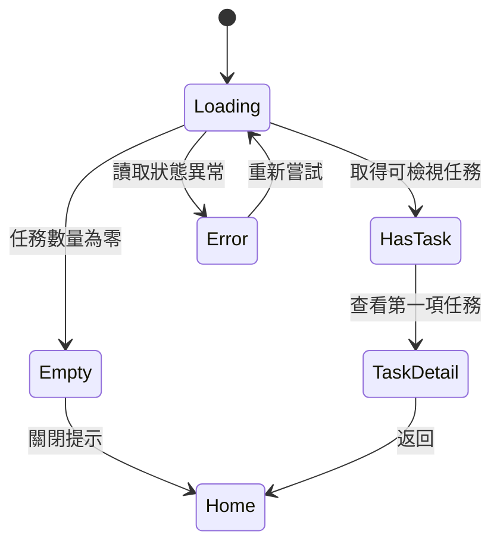
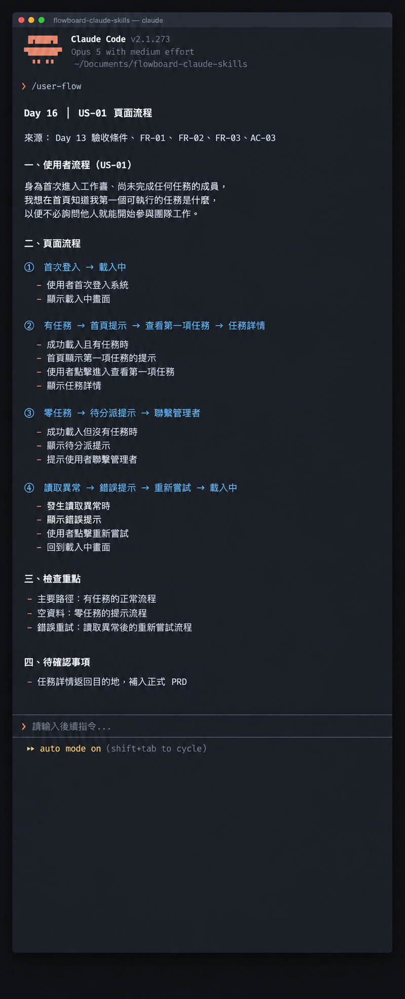

# Day 16 - 用 Claude Code 把 PRD 轉成頁面流程


頁面流程是使用者在系統裡從起點走到終點的真實動線。就像遊樂園地圖，每個路口都要有路標，人才知道往哪走。

## 核心概念拆解


## 三個核心工具

① **狀態移轉圖（State Transition Diagram）**：像捷運路線圖。精確定義：畫出系統在「載入中、有資料、空資料、出錯」之間怎麼跳轉。

② **操作路徑卡（Operation Path Card）**：像步道路標。精確定義：寫清楚「人在哪、做了什麼、系統回什麼、下一步去哪」，並標上 PRD 編號。

③ **頁面責任卡（Page Responsibility Card）**：像服務台告示牌。精確定義：講清楚這個畫面只負責解決哪件事。

## 產出方案選擇

先求動線通順，再求視覺美觀。

① **純文字條列**：簡單有效。寫得快，適合前期對邏輯。

② **狀態卡加 Mermaid 圖**：高效實用。工程和設計看圖對齊最快。

## 規劃規則

① **抓出頭尾與條件**：確定誰在用、從哪進來、要完成什麼。

② **補齊所有分支**：正常流程、沒資料引導、連線失敗重試全部列出。

③ **每一步都要有退路**：能前進也能返回，絕不把人卡死在頁面上。

④ **標註規格來源**：每步對齊 PRD 的功能需求 ID，沒寫到的就是待辦決策。

## 結構化示範：FlowBoard 操作路徑卡

依據 FlowBoard 案例，我們梳理出四條核心操作路徑卡片：

① 操作路徑 P1（主要順利路徑）
- 目前狀態：首次登入首頁、具備指派任務
- 使用者動作：點選「查看第一項任務」按鈕
- 系統回應：開啟任務詳情畫面
- 下一狀態：順利檢視指派任務內容
- 來源 ID：FR-02

② 操作路徑 P2（空資料引導路徑）
- 目前狀態：首次登入首頁、任務清單為零
- 使用者動作：點選「關閉提示」按鈕
- 系統回應：顯示標準工作區首頁
- 下一狀態：探索工作區功能
- 來源 ID：FR-03、決策 D-02

③ 操作路徑 P3（異常復原路徑）
- 目前狀態：任務資料讀取異常
- 使用者動作：點選「重新嘗試」按鈕
- 系統回應：再次發送查詢請求
- 下一狀態：重新載入並顯示對應資料
- 來源 ID：AC-03

④ 操作路徑 P4（檢視後返回路徑）
- 目前狀態：任務詳情頁面
- 使用者動作：點選「返回」連結
- 系統回應：回到工作區首頁
- 下一狀態：標準工作區首頁
- 來源 ID：原型架構決策（標註待補入正式 PRD 規格）

使用 Mermaid 狀態圖呈現動態移轉關係：





四張頁面責任卡片清楚劃分每個畫面的職責邊界：

① 首頁提示卡片
- 回答的問題：我現在可以先做什麼？
- 必要資訊：任務名稱、預計到期日
- 主要行動：點選查看第一項任務
- 職責邊界：專注於引導，詳細編輯留待詳情頁面

② 任務詳情卡片
- 回答的問題：這項工作要求哪些具體產出？
- 必要資訊：標題、狀態、任務細節
- 主要行動：依標準流程執行任務
- 職責邊界：專注於單一任務，導覽功能留給全站導航

③ 待分派任務狀態卡片
- 回答的問題：目前我可以如何尋求協助？
- 必要資訊：待分派任務說明、管理者聯繫指引
- 主要行動：關閉提示並前往工作區
- 職責邊界：專注於狀態引導，建立任務交由管理者操作

④ 載入異常狀態卡片
- 回答的問題：連線發生狀況時我能如何繼續？
- 必要資訊：連線載入提示
- 主要行動：點選重新嘗試
- 職責邊界：專注於重試引導，系統內部細節交由日誌記錄

## 讓 AI 執行流程轉換

```text
角色：你是一位專業的互動流程設計助手，專注將產品規格轉換為完整的操作路徑。

輸入資料：
【貼上 PRD、功能需求 ID、使用者故事、驗收標準與 Demo 範圍】

執行步驟：
① 確立角色與目標：明確定義操作角色、觸發起點、前置條件與成功終點。
② 規劃完整路徑：依序建立主要順行路徑、空資料引導路徑、異常處理路徑與返回路徑。
③ 標記規格來源 ID：為每一步驟標註對應的需求編號；若屬原型新增決策則標註【待補規格】。
④ 檢視動線完整性：確保每個介面皆具備前進與後退出口，每個異常狀態皆具備復原機制。

輸出格式：
操作路徑卡片／狀態移轉圖（Mermaid 格式）／頁面責任清單／待補充決策清單
```

### 範例輸出與核心價值

透過結構化流程轉換，團隊能將文字條文轉變為具備因果關係的動態路徑。這項做法的核心價值在於及早發現路徑中缺乏去向的按鈕與孤立狀態，讓整個操作體驗連貫順暢。

## 人類需要檢查什麼

① 使用者是否能清楚理解自己目前所處的介面位置？
② 主要行動按鈕是否能有效推進使用者的核心目標？
③ 載入重試是否可能引發重複發送事件？
④ 各畫面名詞與按鈕文案是否在整份規格中維持高度一致？

## 把規則封裝成 Claude Code Skill

建立檔案路徑：

```text
.claude/skills/user-flow/SKILL.md
```

設定 YAML 內容：

```markdown
---
name: user-flow
description: 將 PRD 與 Demo 規格轉換為頁面狀態與操作路徑，確保每個動作具備明確去向。
---

請輸出頁面 ID、進入條件、可見內容、使用者動作、下一狀態與離開方式。
標註缺乏去向的按鈕、缺少異常狀態的動線與待拍板的權限邏輯。
專注於既有規格內容，保持操作路徑客觀真實。
```

在 Claude Code 中執行指令：

```text
/user-flow 請讀取 PRD 和 Demo 規格，輸出 US-01 的頁面流程與未決問題。
```

執行 Skill 後，Claude Code 會產出狀態轉移清單，並標註需要補齊去向的操作環節，成為團隊最實用的動線檢查器。

## 今天的產出物


今天完成一份附帶需求來源 ID 的操作路徑卡片、狀態移轉圖與頁面責任卡。當每條路徑都具備明確出口與復原動線，使用者就能在產品中自在穿梭。

## 參考資料

- [Cucumber：Gherkin Reference](https://cucumber.io/docs/gherkin/reference/)
