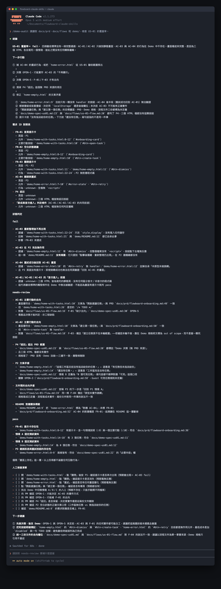

# Day 17 - 用 Claude Code 檢查 Demo 是否符合需求


## 需求追溯驗收

做完 Demo，要怎麼證明它真的符合當初的需求？
就像去驗車，檢驗員拿著清單一條條測煞車、方向燈跟雨刷，每個動作都正常，就蓋章過關。

**就是把規格跟實際操作畫面一條條對齊，用具體證據確認完成度。

## 核心概念拆解


① 需求追溯矩陣（Traceability Matrix）：將每個需求 ID 連結至驗收情境、測試步驟與實際畫面的雙向對照清單。
② 四級判定狀態（Four-Level Verification Status）：依據可觀察證據劃分為完全符合、部分符合、待修正與待查證的客觀評估結果。
③ 階段退出條件（Stage Exit Criteria）：核心需求全數獲得具體驗證證據方能推進至下一開發階段的明確準則。

## 做法與權衡

先求有證據，再求自動化。

① **人工手動對照** _原因_：簡單直接。手動點擊 Demo 並逐條核對，適合前期雛形快速確認。

② **追溯矩陣加上狀態標記** _原因_：清楚好追蹤。把操作截圖、程式碼檔案位置跟需求對齊，方便團隊後續追蹤。

## 執行步驟

① 建立對照表：需求 ID、情境與操作步驟一一對齊。
② 跑過全部流程：記錄操作過程與實際畫面。
③ 貼上狀態標記：依結果標為完全符合、部分符合、待修正或待查證。
④ 寫下差異與負責人：記錄問題、環境與負責人，準備後續回歸測試。

## 結構化示範：FlowBoard 驗收紀錄卡

在 FlowBoard 教學案例中，我們建立五張結構化驗收卡片：

① 驗收卡片 FR-01（首次登入提示）
- 驗收情境：資料情境 A（首次登入、具備任務）
- 實際操作證據：首頁順利顯示歡迎引導與任務名稱
- 判定結果：完全符合
- 下一步：妥善保存操作截圖與原型版本號

② 驗收卡片 FR-02（任務詳情檢視）
- 驗收情境：資料情境 A（查看任務）
- 實際操作證據：順利開啟詳情頁面，返回首頁時提示再次出現
- 判定結果：部分符合
- 下一步：團隊確認返回後的提示保存邏輯，由產品經理裁決

③ 驗收卡片 FR-03（空資料狀態引導）
- 驗收情境：資料情境 B（待分派任務狀態）
- 實際操作證據：顯示待分派說明文字，目前尚缺少關閉提示按鈕
- 判定結果：待修正
- 下一步：補齊關閉提示之點擊按鈕，由設計師提供樣式

④ 驗收卡片 AC-03（連線異常與重試）
- 驗收情境：資料情境 C（讀取異常狀態）
- 實際操作證據：畫面顯示異常提示，點選重新嘗試後順利回到情境 A
- 判定結果：完全符合
- 下一步：精修提示文案之親和力

⑤ 驗收卡片 指標事件追蹤
- 驗收情境：點擊行為與任務完成事件
- 實際操作證據：原型環境使用固定資料，外部事件服務待串接
- 判定結果：待查證
- 下一步：交由後續工程實作與資料團隊接棒驗證

退場條件與回歸測試：
本次展示設定退出條件：FR-01 至 FR-03 的核心互動全數達到「完全符合」，且待查證項目皆指派後續負責人。針對修訂項目執行針對性測試，同時重跑周邊相關動線，確保系統整體穩定。

## 讓 AI 執行驗收比對

```text
角色：你是一位專業的驗收比對助手，專注依據客觀證據審核產品原型。

輸入資料：
【輸入 A：功能需求 ID、使用者故事、驗收標準】
【輸入 B：頁面流程與 Demo 展示範圍】
【輸入 C：逐步操作記錄，含情境、動作、截圖或介面文字反饋】

執行步驟：
① 建立追溯矩陣：逐條對齊需求、驗收情境與實際操作結果。
② 依據證據判定：將結果嚴謹標記為完全符合、部分符合、待修正或待查證。
③ 詳述客觀差異：針對待修正項目記錄具體操作環境與落差細節。
④ 指定後續責任：為待修正與待查證項目指派對應負責人與後續行動。

輸出格式：
需求 ID／驗收情境／操作證據／判定結果／差異說明／下一步行動／負責人
```

### 範例輸出與核心價值

透過結構化驗收卡片，團隊能以客觀事實取代主觀感受。這項做法的核心價值在於為每一次功能展示提供堅實的證據基礎，清楚指出系統符合與需要改進之處。

## 人類需要檢查什麼

① 測試操作所使用的規格版本與原型版本是否完全一致？
② 判定為待修正的項目是否具備明確的重現步驟？
③ 待查證的架構項目是否皆已指定對應的負責團隊？
④ 修正完成後是否落實執行周邊關聯動線的回歸測試？

## 把規則封裝成 Claude Code Skill

建立檔案路徑：

```text
.claude/skills/demo-audit/SKILL.md
```

設定 YAML 內容：

```markdown
---
name: demo-audit
description: 對照 PRD、驗收標準與 Demo 檔案，找出動線缺口、狀態差異與超出範圍的內容。
---

請建立需求 ID 至頁面元件與檔案路徑的對照清單。
每個判定皆附上具體證據、檔案名稱與行號；缺少證據時標註待查證（needs-review）。
輸出 pass、needs-review 與 fail 三種狀態以及專業覆核清單。
```

在 Claude Code 中執行指令：

```text
/demo-audit 請讀取 docs/prd、docs/flows 和 demo/，檢查 US-01 的覆蓋率。
```

實際執行截圖說明：



執行完成後，報告清楚列出需求 ID 與對應程式碼位置，證據待補的項目標註為 needs-review，使驗收過程透明可信。

## 今天的產出物


今天完成一份需求追溯矩陣，提煉出兩項待修正項目與一項交由工程接棒的事件查證清單。當驗收全數立足於可重現的客觀證據，團隊的產品品質便能穩健提升。

## 參考資料

- [Cucumber：Gherkin Reference](https://cucumber.io/docs/gherkin/reference/)
- [Nielsen Norman Group：UX Research Methods Glossary](https://media.nngroup.com/media/articles/attachments/glossary-ux-research.pdf)
