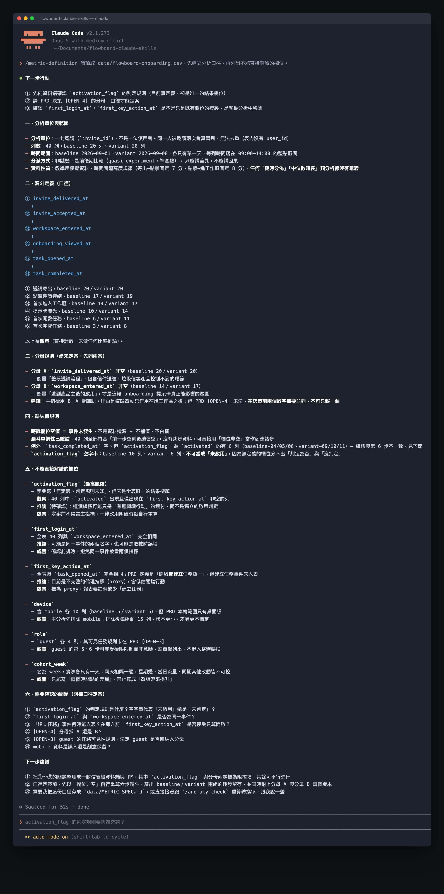

# Day 18 - 用 Claude Code 讀懂產品數據，但先固定口徑


## 如何讓數據分析得出真正可靠的產品結論？

把一堆數字直接丟給電腦計算，只會得到隨機的猜測。

大家排隊量身高時，每個人都要脫掉鞋子、背貼牆壁，量出來的數字才有意義。數據口徑就是這把共同的測量尺，意思是團隊說好用同一個規則去計算，明確規定誰算數、在什麼時間內完成什麼動作。

## 核心概念拆解

要讓分析結果精準有用，必須先拆解三個關鍵要素：

① **分析對象（Cohort）**：特定觀察期間內首次加入工作區的新成員集合。 
② **時間窗口（Time Window）**：每位成員自加入當刻起算的 7×24 小時整。 
③ **封閉漏斗（Closed Funnel）**：要求成員依序觸發事件的轉換模型，每一步驟只計算達成前一步驟的對象。

## 方案與權衡

- **方案 A：單頁文字規格卡**。簡單有效，適合在專案起步與團隊討論時迅速取得共識。
    
- **方案 B：資料字典代碼化與自動檢核**。高效有用，適合在長期追蹤與大型資料庫串接時保持標準一致。

## 執行規則

定義數據分析任務時，請嚴格執行以下三個步驟：

① **鎖定商業目標與分析單位**：寫下具體的產品改進問題，鎖定經過去重後的單一成員加入紀錄。
② **建立明確的事件字典**：定義每個關鍵互動的觸發條件、回傳參數與計算位置。
③ **列出完整的分子與分母**：標記各步驟的轉換計算式，維持步驟間的依序包含關係。

## 結構化示範

以下為 FlowBoard 新成員啟用的教學用模擬定義規格卡：

### 數據分析任務定義卡片

① **商業問題**：觀察新成員在各步驟的留存狀況，對比新版週與基準週的描述性結果。
② **分析單位**：去重後的「成員 × 工作區加入紀錄」。
③ **納入群體**：指定觀察週內首次加入該工作區的新成員。
④ **時間窗口**：每位成員自加入當刻起算的 7×24 小時整。
⑤ **漏斗路徑**：邀請送達 ➔ 接受邀請 ➔ 進入工作區 ➔ 看見提示 ➔ 開啟任務 ➔ 完成任務。
⑥ **漏斗屬性**：封閉且依序；每位成員在每個步驟至多計入一次。
⑦ **主要指標**：7 日任務啟用率 ＝ 7 日內完成任務人數 ÷ 邀請送達人數。
⑧ **輔助指標**：步驟轉換率 ＝ 達成下一步驟人數 ÷ 當前步驟人數。
⑨ **分群條件**：首次進入工作區時採用的裝置類型。

### 事件字典清單卡片

① `invite_delivered`：邀請服務回報送達；記錄工作區識別碼、成員識別碼與時間戳記。
② `invite_accepted`：成員成功點擊並接受指定邀請。
③ `workspace_entered`：成員首次成功載入該工作區介面。
④ `onboarding_viewed`：起始導覽元件於螢幕上實際呈現完畢。
⑤ `task_opened`：成員由引導區塊點擊開啟一項任務檢視。
⑥ `task_completed`：成員將任務狀態更新為完成。


### 兩週模擬數據卡片

① **基準週表現**：
- 邀請送達：20 人
- 接受邀請：16 人（轉換率 16÷20＝80.0%）
- 進入工作區：14 人（轉換率 14÷16＝87.5%）
- 看見提示：10 人（轉換率 10÷14＝71.4%）
- 開啟任務：7 人（轉換率 7÷10＝70.0%）
- 7 日完成任務：5 人（轉換率 5÷7＝71.4%）
- 整體啟用率：5÷20＝25.0%

② **新版週表現**：
- 邀請送達：20 人
- 接受邀請：17 人（轉換率 17÷20＝85.0%）
- 進入工作區：15 人（轉換率 15÷17＝88.2%）
- 看見提示：13 人（轉換率 13÷15＝86.7%）
- 開啟任務：10 人（轉換率 10÷13＝76.9%）
- 7 日完成任務：8 人（轉換率 8÷10＝80.0%）
- 整體啟用率：8÷20＝40.0%

觀察結果顯示，新版週整體啟用率相較基準週增加 15.0 個百分點（計算式為 40.0% 減去 25.0%）。這屬於觀察資料的數值差異，後續需持續收集更多樣本以驗證表現。

## 定義任務的 Prompt

```text
角色：你是一位專業的產品數據分析助理。
任務：接收原始資料前，請先將產品問題轉換為精確的分析規格。

輸入：
- 產品問題說明
- 流程步驟與事件字典
- 資料時間區間與已知條件

執行規則：
① 嚴格遵循既定事件名稱與指標計算公式，遇到定義模糊處標記【待確認】。
② 呈現所有比例時，同步列出分子與分母數據。
③ 描述觀察結果時，使用客觀數值差異語句，保留持續驗證的空間。
④ 優先輸出計算規格表，完成後才請求匯入數據資料。

輸出內容：
商業問題、分析單位、分析群體、分子、分母、時間窗口、漏斗順序、去重規則、分群維度、待確認問題清單。
```

### 範例輸出

```text
商業問題：掌握新成員啟用路徑上的流失分佈，比較兩週表現差異。
分析單位：單一成員在指定工作區的首次啟用歷程。
分析群體：兩週各自納入的 20 筆邀請送達成員。
指標公式：啟用率＝完成任務人數（分子）÷ 邀請送達人數（分母）。
時間範圍：加入後 168 小時內。
待確認清單：跨裝置登入之判定歸屬、測試帳號之名單標記。
```

明確的規格讓後續分析始終對齊真實商業目標，確保每項數字都具備堅實的依據。

## 人類需要檢查什麼

審核數據規格時，請依據以下清單逐一確認：

① 指標價值：確認當前指標確實代表產品的核心價值。
② 埋點完整度：檢查事件觸發時機是否與使用者的真實互動完全一致。
③ 去重正確性：確認跨裝置使用或重複點擊時，分子與分母維持一人一票的規則。
④ 比較基礎：檢視兩段期間的使用者來源與環境條件是否具備可比性。


## 把規則封裝成 Claude Code Skill

建立規格檢查技能檔：

~~~text
.claude/skills/metric-definition/SKILL.md
~~~

~~~markdown
---
name: metric-definition
description: 協助產品經理在讀取資料前固定欄位、事件、分母與時間窗，確保分析口徑精確一致。
---

請優先列出資料字典、分析單位、時間範圍、分母與待確認項目。
遇到欄位定義模糊時，暫停後續計算並列出需要釐清的問題清單。
清楚區分客觀觀察數據與後續待驗證假設，忠實呈現數值差異。
~~~

執行指令：

~~~text
/metric-definition 請讀取 data/flowboard-onboarding.csv，建立分析口徑，並標記需要進一步釐清的欄位。
~~~

執行後終端機畫面會完整保留資料來源、口徑清單與待查項目：



## 今天的產出物

今天完成的成果是**數據分析任務定義表與事件字典卡片**。
每項數據比例都擁有清晰的分母與計算基準，讓團隊在展開深入分析前，已具備統一且可信的度量基礎。

## 參考資料

- [Google Analytics：Funnel exploration](https://support.google.com/analytics/answer/9327974?hl=en)
- [Google for Developers：Set up events](https://developers.google.com/analytics/devguides/collection/ga4/events)
