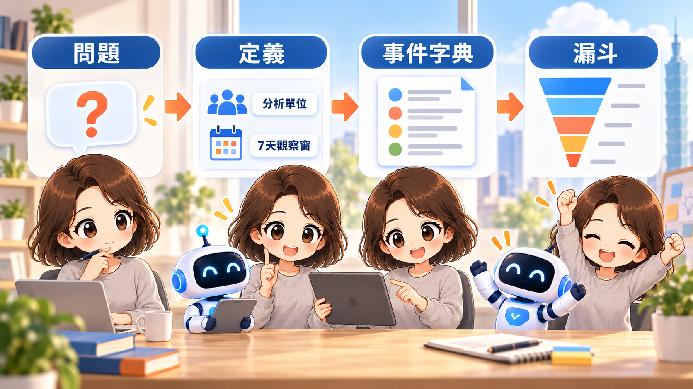

# Day 18｜產品人該怎麼用 AI 看懂業務數據？


「請分析這份 CSV」聽起來有效率，卻把最重要的產品決定交給模型猜：要分析誰、哪段時間、完成什麼才算成功？今天先定義問題，再計算數字。

## 今天要解決的問題

我們想知道 FlowBoard 新成員啟用流程的表現，但「啟用」不是資料庫裡天然存在的真理。團隊必須選擇能代表產品價值的可觀察行為。本案例暫定為：新成員加入工作區後 7×24 小時內，至少完成一項任務。

漏斗也要先說明開放或封閉、步驟順序與時間限制。以 GA4 官方說明為例，封閉漏斗要求使用者由第一步進入，且只計入依序完成的步驟；工具設定不同，數字就可能不同。[Google Analytics：Funnel exploration](https://support.google.com/analytics/answer/9327974?hl=en)

本文資料全是教學用模擬資料，目的在示範定義與手算，不代表真實產品成效。

## 先寫數據分析任務定義表

| 欄位 | FlowBoard 定義 |
|---|---|
| 商業問題 | 新成員在哪個步驟流失？新版期間的描述性結果與基準期有何差異？ |
| 分析單位 | 去重後的「成員 × 工作區加入紀錄」 |
| Cohort | 在各觀察週內首次加入該工作區的新成員 |
| 時間窗 | 每位成員自加入時間起 7×24 小時 |
| 漏斗 | 邀請送達→接受邀請→進入工作區→看見提示→開啟任務→完成任務 |
| 漏斗類型 | 封閉、依序；每人每步最多計一次 |
| 排除 | 測試帳號、邀請未送達、停權成員；排除數需另報 |
| 主要指標 | 7 日任務啟用率＝7 日內完成任務人數÷邀請送達人數 |
| 輔助指標 | 各步到下一步轉換率；以當前步驟人數為分母 |
| 分群 | 進入工作區時的裝置類型；跨裝置仍歸首次進入裝置 |

事件是對互動的量測；例如頁面載入、點擊與完成動作。Google Analytics 官方也將 event 描述為網站或 App 的使用者互動量測。[Google for Developers：Set up events](https://developers.google.com/analytics/devguides/collection/ga4/events)

## 事件字典比欄位名稱更重要

```text
invite_delivered：邀請服務回報送達；參數 workspace_id、member_id、timestamp
invite_accepted：成員成功接受指定邀請
workspace_entered：接受後首次成功載入該工作區
onboarding_viewed：起始提示實際呈現；不可只記伺服器回應
task_opened：由提示開啟一項可檢視任務
task_completed：該成員將任務狀態改為完成
```

每個事件還需有擁有者、版本、時區、去重鍵與品質檢查。`task_completed` 若重送兩次，分子仍只能算同一人一次。



## 可手算的模擬資料

| Cohort | 邀請送達 | 接受 | 進入 | 看見提示 | 開啟任務 | 7 日完成 |
|---|---:|---:|---:|---:|---:|---:|
| 基準週 | 20 | 16 | 14 | 10 | 7 | 5 |
| 新版週 | 20 | 17 | 15 | 13 | 10 | 8 |

兩週各有 20 筆符合納入條件的邀請，表中的人數依序包含於前一步。例如新版週 7 日任務啟用率為 `8÷20＝40%`；基準週為 `5÷20＝25%`，觀察差為 `+15 個百分點`。這不是「成長 15%」；若表達相對變化才是 `(40%-25%)÷25%=60%`。

樣本只有每組 20 人，且不是隨機實驗。季節、邀請來源、團隊成熟度與其他產品改動都可能不同，不能說新版「造成」提升。這裡只能說新版週觀察值較高，值得持續蒐集與設計更可靠的比較。

## 定義任務的 Prompt

```text
你是產品分析助理。收到資料前，先把問題轉成分析規格。

輸入：【產品問題、流程、事件字典、資料期間、已知限制】
輸出：商業問題、分析單位、cohort、分子、分母、時間窗、漏斗順序、
納入與排除、去重規則、分群、資料品質檢查、可回答與不可回答的問題。

規則：
- 不自創事件或指標定義；不足處標【待確認】。
- 百分比一律同時列分子與分母。
- 比較觀察資料時不得使用「造成」「證明有效」。
- 先列計算式，再要求資料。
```

## 人類需要檢查什麼

產品人決定指標是否代表價值；分析與工程確認事件是否按定義發生；業務理解分群與期間是否可比。尤其要檢查機器人、測試帳號、事件延遲、時區和跨裝置去重。AI 能照公式計算，不能自行確認埋點真的對。


## 今天的產出物

今天完成數據分析任務定義表、事件字典與兩週模擬漏斗。明天會逐步計算轉換與流失，找出值得追查的差異，同時把「觀察」與「原因假設」分開。

## 參考資料

- [Google Analytics：Funnel exploration](https://support.google.com/analytics/answer/9327974?hl=en)
- [Google for Developers：Set up events](https://developers.google.com/analytics/devguides/collection/ga4/events)
