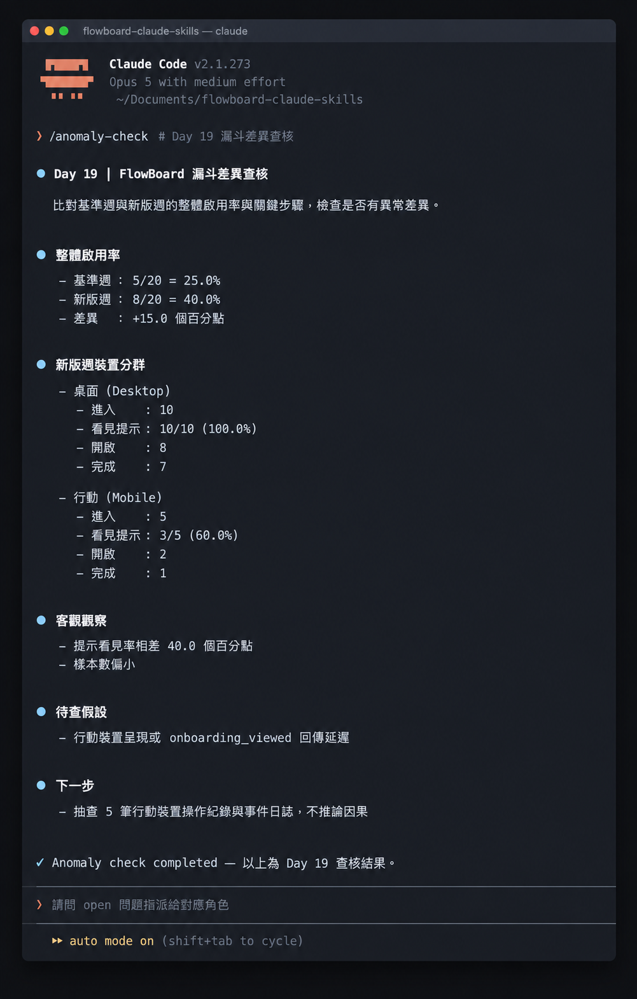

# Day 19 - 用 Claude Code 找數據異常，專注客觀查證


## 數字為什麼會突然跳動？

就像偵探用放大鏡找腳印，數據異常是實際數字和原本預期的落差，讓我們知道真實狀況是什麼。

  

## 核心概念

① 數值落差（Metric Gap）：
兩個群組在相同計算標準下的數字差與百分點差。

② 維度切分（Segmentation）：
依照使用者屬性把整體資料拆成獨立小群體的分析方法。

③ 待查假設（Hypothesis for Investigation）：
團隊針對數值落差提出的可能原因，需要靠後續行動來驗證。

## 方案與權衡

- 方案 A：單一維度交叉比對。原因是範圍集中且容易直接定位問題。 
- 方案 B：自動化異常偵測流程。原因是能全面覆蓋並即時發現潛在波動。

## 執行規則

① **重新核算各步驟轉換率**：依精確口徑計算各階段轉換百分比，同時保留原始分母與分子。
② **展開關鍵維度分群檢視**：切分終端設備或通路來源，觀察各子群體在總體數字下的真實分佈。
③ **條列待查假設與驗證動作**：將數據落差轉化為具體的查證任務，安排負責成員依序核對系統紀錄。

## 結構化示範

### 轉換率計算卡片

- **基準週轉換歷程**
  - 邀請接受率：16÷20＝80.0%
  - 工作區進入率：14÷16＝87.5%
  - 提示看見率：10÷14＝71.4%
  - 任務開啟率：7÷10＝70.0%
  - 開啟後完成率：5÷7＝71.4%
  - 全程啟用率：5÷20＝25.0%

- **新版週轉換歷程**
  - 邀請接受率：17÷20＝85.0%
  - 工作區進入率：15÷17＝88.2%
  - 提示看見率：13÷15＝86.7%
  - 任務開啟率：10÷13＝76.9%
  - 開啟後完成率：8÷10＝80.0%
  - 全程啟用率：8÷20＝40.0%

### 裝置分群排查卡片

- **桌面裝置群組**
  - 進入工作區：10 人
  - 看見提示：10 人（看見率 100.0%）
  - 開啟任務：8 人
  - 7 日完成任務：7 人

- **行動裝置群組**
  - 進入工作區：5 人
  - 看見提示：3 人（看見率 60.0%）
  - 開啟任務：2 人
  - 7 日完成任務：1 人



> 兩個裝置群組的看見率差距 40.0 個百分點，成為團隊優先追查的關鍵線索。

## 分析任務的 Prompt

```text
角色：你是一位嚴謹的產品數據分析助理。
任務：完全依據既定定義與原始計數展開計算，將數值差異轉化為查證指引。

輸入：
- 指標定義：各步驟分子、分母、時間窗口與去重規則
- 原始資料：包含各階段實際人數計數的數據清單

執行規則：
① 驗證漏斗數據是否維持遞減或持平，標記異常遞增項目。
② 計算各步驟轉換率與流失人數，同步呈現百分點差異。
③ 展開分群計算，特別標記樣本數偏小的群體。
④ 將產出嚴格區分為「客觀數據觀察」「待驗證假設」與「後續查證行動」三個區塊。

輸出內容：各步轉換率計算結果、關鍵分群比較、客觀觀察結論、待查驗假設與具體行動步驟。
```

### 範例輸出

```text
客觀觀察：新版週 8/20（40.0%）於 7 日內完成任務；基準週為 5/20（25.0%），差異為增加 15.0 個百分點。
客觀觀察：新版週行動裝置提示看見率 3/5（60.0%），桌面裝置 10/10（100.0%）。
待查假設：行動裝置介面元件在特定螢幕尺寸下的呈現狀況需要檢視。
查證行動：調閱行動裝置客戶端日誌、比對 5 筆操作紀錄，持續追蹤數據穩定性。
```

## 人類需要檢查什麼

① 原始紀錄查驗：抽查個別使用者的操作紀錄，確認事件時間與觸發順序。
② 口徑一致性：檢查各個時期的資料來源和篩選條件，確認符合定義。
③ 樣本規模意識：當樣本數太少時，把比例波動當成參考線索，持續擴大採樣。
④ 查證優先序：根據潛在影響力，安排工程與產品團隊的調查順序。

## 把規則封裝成 Claude Code Skill

```text
.claude/skills/anomaly-check/SKILL.md
```

```markdown
---
name: anomaly-check
description: 依據既定數據口徑計算轉換率與分群差異，標示數值落差並產出客觀查證清單。
---

請優先重算分子、分母與步驟轉換率，保留原始精確數值。
清楚區分整體人數落差與特定分群表現，標示小樣本群組。
將結論分為客觀觀察、待查假設與具體驗證步驟，保持事實與推論的分界。
```

執行指令：

```text
/anomaly-check 請讀取 data/flowboard-onboarding.csv，依 Day 18 口徑計算並列出優先查證項目。
```


## 今天的產出物 

今天完成了數據轉換漏斗與異常排查卡片。清楚的步驟計算與群組落差，幫助團隊找出系統問題，並作為下一步動手驗證的最強依據。

## 參考資料

- [Google Analytics：Funnel exploration](https://support.google.com/analytics/answer/9327974?hl=en)
- [Google Analytics：Create a custom funnel report](https://support.google.com/analytics/answer/13012015?hl=en)
