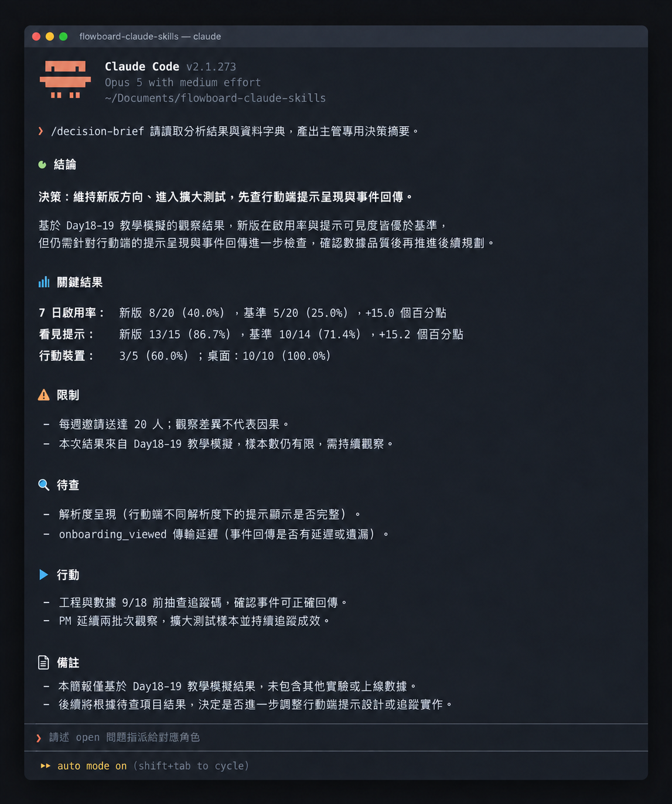

# Day 20 - 用 Claude Code 產生可追溯的一頁式結論


### 把數據分析轉化為團隊的果斷行動

一頁式決策結論能將複雜數據濃縮為結構化摘要，協助團隊快速達成共識並採取行動。

## 核心架構包含四個層次


① **核心發現（Core Findings）**：由既有數據直接計算出的客觀事實。

② **支援證據與限制（Evidence and Boundaries）**：說明分子、分母、時間範圍與取樣條件的邊界。

③ **待驗證假設（Hypotheses for Verification）**：針對數值落差提出的候選原因，標註為待驗證狀態。

④ **執行決策與行動（Decisions and Next Steps）**：包含明確負責人、完成期限與驗證標準的行動清單。

## 方案與權衡

整理決策摘要時，團隊能依據現有資源權衡兩種做法：

- **方案 A：固定結構的單頁規格卡**。原因是結構固定且便於管理角色快速掌握重點。此方案簡單有效，適合在例行週會或專案同步時高效溝通。
- **方案 B：具備數據連動的動態看板**。原因是資訊即時刷新且支援點擊深入探索。此方案高效有用，適合在長期跨部門監控多項核心商業指標時使用。

## 執行規則

產出一頁式決策結論時，請嚴格執行以下三個步驟：

① **提煉關鍵核心發現**：挑選三項以內的重大數據觀察，同步呈現完整分子、分母與百分比。
② **明確界定數據適用邊界**：清楚標記樣本規模與觀察條件，讓決策者掌握推論的有效範圍。
③ **制定具體行動與負責人**：為每項待查假設指定單一負責窗口、完成時限與後續判斷標準。

## 結構化示範

以下為 FlowBoard 團隊運用教學用模擬資料產出的一頁式決策卡片：

### 一頁式決策摘要卡片

① **核心決策方針**：
推進新版導覽功能進入下一階段實證，本週全力投入行動裝置提示呈現與事件回傳排查。

② **三大關鍵發現**：
- 發現 1：新版週共有 8/20（40.0%）新成員於加入後 7×24 小時內完成至少一項任務；基準週為 5/20（25.0%），數值提升 15.0 個百分點。
- 發現 2：新版週 15 位進入工作區者中，13 位看見提示（86.7%）；基準週為 10/14（71.4%），數值提升約 15.2 個百分點。
- 發現 3：新版週行動裝置提示看見率為 3/5（60.0%），桌面裝置為 10/10（100.0%）。


③ **資料邊界與限制**：
- 觀察樣本為每組 20 筆邀請送達紀錄，個別成員行為對總體百分比影響顯著。
- 資料屬於特定兩週之觀察紀錄，使用者屬性分佈仍需長期追蹤。
- 裝置分群分母各為 5 與 10，數據落差適合作為技術排查的重要指引。

④ **原因假設與查證方針**：
- 假設 H1：行動裝置介面元件在特定解析度下的呈現狀態需進一步優化。查證方式：調閱行動裝置客戶端日誌並核對 5 筆操作歷程。
- 假設 H2：`onboarding_viewed` 事件在行動端傳輸時存在延遲。查證方式：比對測試環境與生產環境的日誌回傳狀態。

⑤ **具體後續行動**：
- 工程與數據團隊：於 2026-09-18 前完成行動端事件追蹤碼抽查。
- 產品經理：持續收集後續兩個批次的新成員啟用表現，沿用相同定義。
- 檢驗分歧點：確認畫面呈現異常時立即修復；若屬於埋點問題則校正事件後重設基準。

## 摘要產出的 Prompt

```text
角色：你是一位專業的高階決策簡報專家。
任務：將已經團隊核對的數據分析成果濃縮為一頁式決策卡片，維持論據的嚴謹性。

輸入：
- 指標定義與資料收集區間
- 已驗證的步驟轉換計算卡片
- 數據觀察、候選假設、邊界限制與待決策事項

執行規則：
① 提煉一句明確的行動決策指引置於首位。
② 呈現三項以內的關鍵發現，每項均完整保留分子、分母、計算比例與對比基準。
③ 詳盡列出樣本規模與觀察條件等資料限制。
④ 將候選解釋嚴格標記為待查假設，並附帶對應的驗證手段。
⑤ 列出具備負責人、完成期限與驗證標準的下一步行動清單。

輸出內容：
行動決策、核心發現、解讀限制、待查假設與查證清單、下一步行動排程。
```

### 範例輸出

```text
行動決策：維持新版方向並進入擴大測試，優先鎖定行動裝置介面呈現進行技術調校。
核心發現：新版週啟用率達到 8/20（40.0%），基準週為 5/20（25.0%），差距為 +15.0 個百分點。
解讀限制：樣本規模為每組 20 筆資料，數據變動指引排查方向，待後續梯次驗證成效。
待查假設：行動裝置介面渲染需要優化；安排 5 筆日誌深度比對。
下一步：由工程負責人於本週五前交付檢驗報告，產品經理同步展開新一輪樣本追蹤。
```

這項結構確保管理層在十秒內掌握核心現狀，並在完整證據的支持下迅速核准資源配置。



## 人類需要檢查與決策的地方

審核一頁式決策摘要時，請依據以下清單逐一核對：

① 結論邊界檢視：確認決策範圍精準落在既有數據證據之內。
② 行動可行度：評估指派任務的資源投入與驗證成本是否符合當前優先順序。
③ 停止條件設定：確認各項排查任務皆具備清楚的驗證期限與驗收標準。
④ 團隊共識度：確保產品、工程與數據團隊對假設的定義保持完全一致。


## 把規則封裝成 Claude Code Skill

建立決策摘要技能檔：

~~~text
.claude/skills/decision-brief/SKILL.md
~~~

~~~markdown
---
name: decision-brief
description: 將已核對的數據分析成果整理為具備可追溯性的一頁式決策摘要，清楚區分發現、證據、假設與行動。
---

請優先列出一句核心決策，並列出三項包含完整分子與分母的關鍵數據發現。
將所有潛在原因明確標示為待驗證假設，並註明對應之查證方案。
詳列樣本規模與觀察條件之限制，並為每項行動標註負責人、期限與檢驗標準。
~~~

執行指令：

~~~text
/decision-brief 請讀取分析結果與資料字典，產出主管專用決策摘要，並標記需由人工確認的數值。
~~~

執行後終端機畫面會完整呈現帶有分母的發現、清楚標註的待查假設以及具體負責人清單，確保資訊透明且可追溯。

## 今天的產出物

今天完成的成果是**一頁式數據決策摘要卡片**。
這項工具將數據計算無縫轉化為組織行動，讓團隊在掌握明確邊界的前提下，信心十足地邁向下一個迭代階段。

## 參考資料

- [Google Analytics：Funnel exploration](https://support.google.com/analytics/answer/9327974?hl=en)
- [Google for Developers：Set up events](https://developers.google.com/analytics/devguides/collection/ga4/events)
