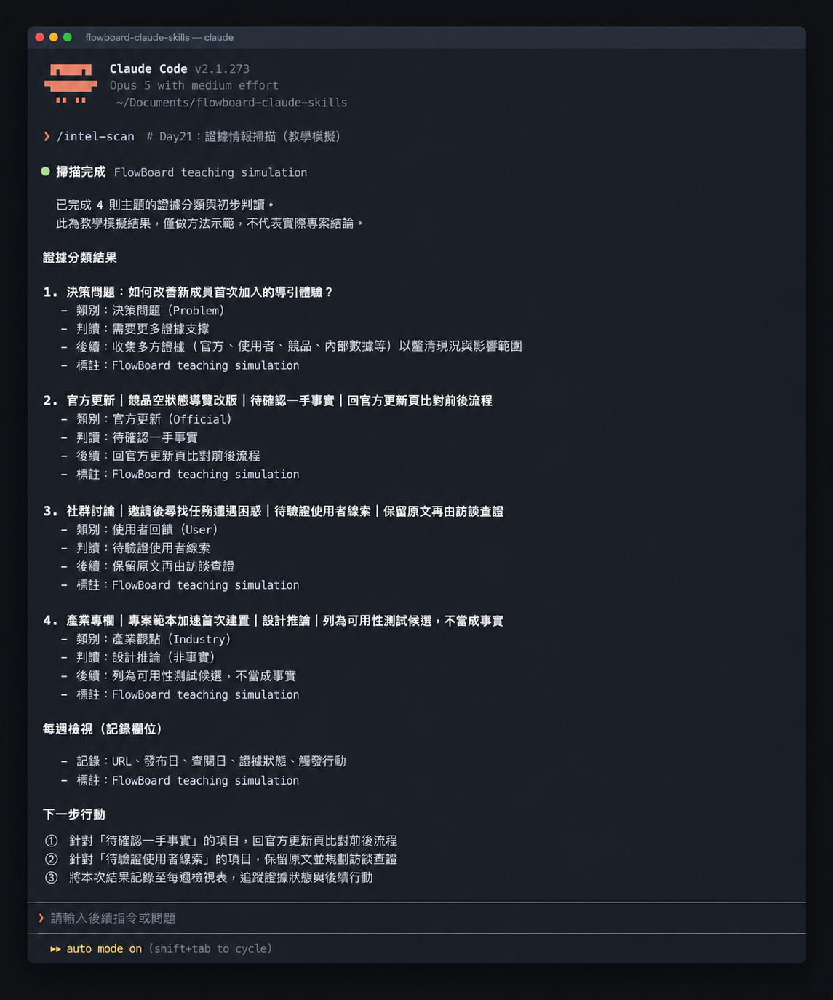

# Day 21 - 用 Claude Code 建立產品情報雷達


## 為何要有產品情報雷達

產品情報雷達是用來過濾龐大資訊、精準掌握產品決策關鍵訊號的觀測系統。

## 核心概念拆解

要打造一套敏銳且高價值的情報雷達，必須先建立四層來源階梯：

① 一手官方來源：官方發布之更新日誌、功能說明中心與主管機關條文原文。
② 專業研究與報導：承擔事實查核責任的專業研調機構與權威媒體之深度分析。
③ 社群討論與評論：使用者於公開網路留下的真實體驗與抱怨，適合作為待驗證的靈感線索。
④ 網路彙整與摘要：轉述他人內容的二次整理資訊，需回溯至一手來源進行核實。

## 方案與權衡

建立情報雷達時，團隊能依據現有資源權衡兩種做法：

方案 A：固定主題的人工週報掃描。因為資訊精煉且能完全聚焦核心決策，適合在團隊規模精簡時每週投注半小時維持高度專注。 

方案 B：自動化訂閱與關鍵字管線。因為追蹤廣泛且能即時接收多方來源，適合在追蹤多個大型成熟競品與法規動態時節省收集時間。

## 執行規則

設計情報雷達時，請嚴格執行以下三個步驟：

① 錨定核心產品決策問題：從當前待突破的產品瓶頸出發，界定真正關心的情報邊界。 
② 劃定權威資訊來源階梯：優先選取官方更新與權威文件，將社群討論明確標註為待查線索。 
③ 建立明確的觸發行動機制：為每項納入雷達的情報設定具體對應作為，包含建立觀察卡、安排訪談或展開技術驗證。

## 結構化示範

以下為 FlowBoard 團隊以專案協作產品為核心所規劃的情報雷達卡片：

### 決策問題與追蹤主題卡片

① **介面引導決策**：
- 核心問題：該如何優化新成員首次加入時的導引體驗？
- 追蹤主題：競品新成員啟用流程、初始空白畫面呈現、範本指引設計。
- 優先來源：官方更新發布紀錄、產品官方教學文件、第一線實機體驗。
- 追蹤週期：每週固定檢視。
- 觸發行動：發現流程重大更新時，立即產出功能拆解卡片。

② **智慧協同決策**：
- 核心問題：該如何引入 AI 任務輔助功能以提升協作成效？
- 追蹤主題：AI 協同工作機制、權限劃分架構、輔助推薦失敗處理流程。
- 優先來源：官方技術白皮書、工程技術架構文件。
- 追蹤週期：每週固定檢視。
- 觸發行動：當影響現有架構假設時，安排跨部門技術評估會議。

③ **資料治理決策**：
- 核心問題：哪些隱私與資料管理規範需在設計初期完成佈局？
- 追蹤主題：資料保存規範、第三方運算服務隱私政策、主管機關指引。
- 優先來源：主管機關法規條文、官方服務條款最新公告。
- 追蹤週期：每月固定檢視及重大更新時即時跟進。
- 觸發行動：提交法務與資訊安全團隊進行合規確認。

④ **需求普遍度決策**：
- 核心問題：新成員遇到的上手障礙是否屬於產業普遍痛點？
- 追蹤主題：公開論壇討論串、應用市集使用者評分與回饋。
- 優先來源：社群公開專題討論、產品評論專區。
- 追蹤週期：每週固定檢視。
- 觸發行動：彙整為待驗證使用者假說，並回查內部訪談紀錄比對。


### 來源分級卡片範例

① **主題：協作軟體空狀態導覽改版**
- 資訊性質：待確認之一手事實
- 建議來源：官方產品更新頁面
- 觸發行動：前往官方網站比對前後版面並記錄新流程

② **主題：使用者反應邀請後尋找任務遭遇困惑**
- 資訊性質：待驗證之使用者線索
- 建議來源：社群公開問答討論區
- 觸發行動：收集原始發言截圖並於內部使用者訪談中深入驗證

③ **主題：運用專案範本加速首次建立專案速度**
- 資訊性質：產品設計推論
- 建議來源：產業專家分析專欄
- 觸發行動：整理為產品假設，納入後續可用性測試選項



## 主題盤點的 Prompt

```text
角色：你是一位頂尖的產品情報研究專家。
任務：依據核心「決策問題」提出具備清晰邊界的情報追蹤主題。

輸入：
- 產品定位：服務 10 至 50 人團隊的敏捷專案協作工具
- 當前目標：提升新成員進入工作區後的任務啟用表現
- 核心決策問題清單

執行規則：
① 每個追蹤主題均緊扣特定決策問題，指引後續實質動作。
② 嚴格引用既有官方紀錄與實證內容，確保來源具備權威性。
③ 將社群內容與專家意見一律標記為【待驗證線索】。
④ 限縮追蹤範圍至團隊能於每週 30 分鐘內完成檢視的精煉規模。

輸出內容：
追蹤主題、對應決策、來源層級、檢索關鍵詞、檢視頻率、觸發行動條件。
```

### 範例輸出

```text
追蹤主題：競品新成員首次登入引導改版動態
對應決策：評估 FlowBoard 是否調整歡迎頁面三張卡片佈局
來源層級：一手官方更新紀錄
檢索關鍵詞："onboarding" OR "welcome screen" release notes
檢視頻率：每週一上午檢視
觸發行動：官方有新發布時，記錄元件並產出拆解卡片
```

透過精確的主題與來源定義，情報雷達發揮出如同精準導航般的功效，讓團隊掌握最關鍵的外部動態。

## 人類需要守住的四道關卡

在審視進入雷達的情報時，請依據以下四道關卡嚴格把關：

① 來源身分核驗：確認作者身分、發布機構、原始網址與發布日期。
② 時效性確認：記錄「資訊發布日期」與「團隊查閱日期」，確保內容維持最新狀態。
③ 決策關聯度評估：確認該情報能直接為當前 FlowBoard 的啟用目標提供參考。
④ 行動明確度落實：為每則情報指定明確動作，包含持續關注、深入調研、展開實驗或存檔備查。


## 把規則封裝成 Claude Code Skill

建立情報雷達掃描技能檔：

~~~text
.claude/skills/intel-scan/SKILL.md
~~~

~~~markdown
---
name: intel-scan
description: 依據產品決策問題整理產業情報來源與觀察卡，完整保留來源網址、發布日期與證據狀態。
---

請優先依據決策問題限縮檢索範疇，依序標記來源層級。
每張情報卡均需包含來源出處、發布時間、核心主張、證據狀態與具體觸發行動。
社群回饋與個人觀點一律標註為待驗證線索，引導團隊回到一手資料進行查證。
~~~

執行指令：

~~~text
/intel-scan 請依據 docs/product-context.md 的決策問題，檢查 sources/ 目錄並產出本週情報卡。
~~~

執行後終端機畫面會完整保留來源網址、發布時間與證據狀態標籤，確保每一則外部情報都能追溯至權威出處。

## 今天的產出物

今天完成的成果是**產品情報雷達設定卡片與來源分級規格**。
團隊從漫無目的的資訊瀏覽，進化為主動且精準的決策信號監測，為產品演進建立起穩固的情報基礎。

## 參考資料

- [Claude Code 官方文件：Extend Claude with skills](https://code.claude.com/docs/en/skills)（查閱日期：2026-09-16；用於說明專案級 Skill 的使用方式）
