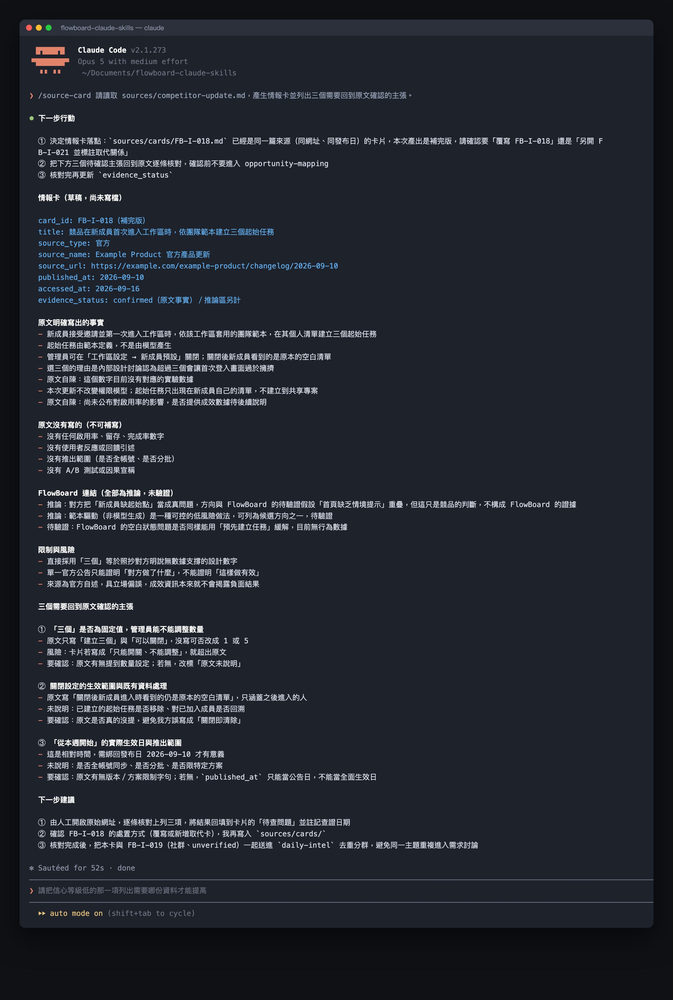

# Day 22 - 用 Claude Code 把文章變成可追溯情報卡


### 報導轉化為可用決策

看競品文章最常犯的錯，是把「別人的宣傳」直接當成「產品該做的事」。

解決方法是做一張**可追溯情報卡**：強制把「客觀事實」與「自家推論」拆成兩階段處理。

## 什麼是可追溯情報卡？

它像一張透明的食品標籤，清楚標示產地與成分。

精確定義為：**將外部文章拆解為原文事實、邊界限制、情境推論與驗證行動的結構化卡片。**

製作卡片必須嚴格拆成兩個階段：

① **第一階段：客觀事實抽取（Objective Fact Extraction）**

只記錄原文真正寫出來的內容（來源、時間、功能、限制）。原文沒給成效數據，就標註【尚待補充】，絕不腦補。

② **第二階段：產品情境對齊（Product Context Alignment）**

這時才帶入自家產品現況，寫出可能的機會與風險。所有想法一律標記為【推論】，並且每一條都要附帶「怎麼驗證」。

## 兩種落地做法與權衡

團隊可依需求選擇以下方案：

- **方案 A：兩階段提示詞（Prompting）**。優點是手動分步確認，事實與推論邊界最乾淨。適合深度分析單篇重量級競品發布。
    
- **方案 B：Claude Code 專用技能（Skill）**。優點是一鍵批次處理大量文章。適合日常高頻率掃描產業動態。

## 執行規則

產出可追溯情報卡時，請嚴格執行以下三個步驟：

① **抽取原始來源之核心事實**：完整保留出處網址、發布日期、機構名稱與原文記載的具體功能敘述。
② **標記文章所載之邊界限制**：詳細記錄原文提及的使用資格、限制條件或尚待補充的成效指標。
③ **結合自身產品展開影響推論**：條列產品機會與潛在風險，將每項推論明確標註為待查問題並指派後續驗證動作。

## 結構化示範

以下為 FlowBoard 團隊針對模擬競品更新公告所產出的兩階段情報卡：


### 第一階段：原始事實抽取卡片

① **基本資訊**：
- 來源名稱：Example Product 官方更新日誌
- 發布日期：2026-09-10
- 查閱日期：2026-09-16
- 原始網址：https://example.com/updates/onboarding-templates

② **原文明確主張**：
- 事實 1：新成員進入工作區時，系統依據團隊範本提供三個起始任務建議。
- 事實 2：管理者擁有開啟或關閉該項建議功能的控制權限。
- 數據記載：原文保留成效數據之空白，尚待後續追蹤。
- 適用邊界：目前提供採用團隊範本之組織使用。

### 第二階段：FlowBoard 產品情境推論卡片

① **核心結論**：
值得評估依據團隊屬性提供初始任務的可行性，優先核實新成員對指派任務的真實期待。

② **情境拆解項目**：
- 核心影響：此設計能減輕新成員初次面對空白畫面時的選擇成本。
- 潛在機會：運用 FlowBoard 現有之團隊範本架構，製作低成本引導原型。
- 風險考量：推薦任務若偏離實際需求，可能增加使用者的理解負擔。
- 待查問題：新成員的核心卡點究竟在於缺少任務清單，抑或是對團隊權限與專案背景理解不足？
- 建議動作：調閱內部新成員訪談逐字稿比對，並安排 5 位使用者進行可用性測試。
- 信心等級：初始探索階段（依據官方功能公告，待補充成效數據）。

## 摘要產出的 Prompt

```text
角色：你是一位具備敏銳洞察力的產品策略助理。
任務：以兩階段流程將長篇文章轉換為保留事實脈絡的可追溯情報卡。

輸入：
- 外部文章全文或精確摘要
- 自身產品定位與當前核心挑戰

執行規則：
① 第一階段完全聚焦輸入文章，抽取來源名稱、網址、發布日期、核心事實與數據。遇到原文省略之處標記【尚待補充】。
② 第二階段結合自身產品背景，產出潛在影響、機會、風險與待驗證問題。
③ 將所有對自身產品的解讀嚴格標記為【推論】或【假設】。
④ 為每個推論指派明確的驗證動作與信心評級。

輸出內容：
來源資訊、原文事實、原文限制、情境推論、機會與風險、待查問題、下一步驗證行動、信心等級。
```

### 範例輸出

```text
來源資訊：Example Product 官方發布日誌（2026-09-10）
原文事實：官方發布團隊範本起始任務建議功能，具備管理員控制開關。
產品推論：團隊範本有助於縮短新成員摸索時間，可作為引導優化參考。
機會與風險：具備現成範本可直接利用；需防範任務推薦失準帶來的困擾。
待查問題：團隊成員是否期待系統主動指派初始任務？
驗證行動：本週完成既有訪談資料交叉比對，產出驗證報告。
信心等級：低（僅屬單一競品發布，尚待成效數據佐證）。
```

這項輸出確保團隊在汲取外部情報時，始終保持清晰的客觀態度，把市場動態轉化為紮實的研究步驟。

## 人類要檢查什麼

卡片產出後，花 1 分鐘檢查：

① **點擊原文連結**：抽查關鍵事實，確認不是 AI 憑空捏造。

② **檢查限制條件**：確認版本資格與適用範圍沒有漏記。

③ **核對推論邏輯**：確認推論確實扣合自家產品當前的目標。

④ **確認驗證動作**：確認每個推論都有指定「誰去查、怎麼查」。


## 把規則封裝成 Claude Code Skill

建立來源摘要技能檔：

~~~text
.claude/skills/source-card/SKILL.md
~~~

~~~markdown
---
name: source-card
description: 將指定來源整理為可追溯情報卡，清楚區分原文事實、邊界限制、情境推論與待查問題。
---

請優先抽取來源網址、發布日期、作者與明確載明之核心事實。
第二階段才結合團隊產品情境，將所有影響與機會標記為推論或待驗證假設。
嚴格引用原文載明的事實與數據，標記原文省略或尚待補充之項目。
~~~

執行指令：

~~~text
/source-card 請讀取 sources/competitor-update.md，產出情報卡並列出三個需回到原文確認的主張。
~~~

執行後終端機畫面會完整保留來源網址與發布日期，並清楚區分原文事實與產品情境推論，最後條列出三個需回查原文的關鍵主張：



在執行網路檢索與資料整理時，請全程遵循網站存取規範與組織資安政策，確保資料蒐集過程安全可靠。

## 今天的產出物

今天完成的成果是**可追溯情報卡模板與兩階段萃取流程**。
這項工具協助團隊在面對海量外部資訊時，既能快速掌握重點，又能精確守住事實真相，為產品迭代提供最強而有力的決策情報支持。

## 參考資料

- [Claude Code 官方文件：Extend Claude with skills](https://code.claude.com/docs/en/skills)
