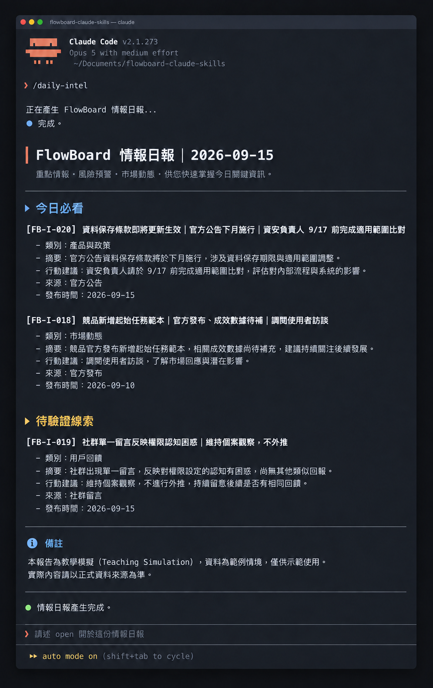

# Day 23 - 用 Claude Code 產生每日情報日報草稿


## 每日情報日報的核心目的

**透過客觀加權排序，把零散的市場情報收斂成「3 則今日必看」與「指派負責人的具體行動」。**
不讓團隊被海量雜訊淹沒，重點在於排順序與定責任。

## 什麼是每日情報日報？


它像急診室的檢傷分類站，先處理最緊急的病人。
**依據客觀加權規則，將分散的情報卡完成語意整併、價值排序並指派行動責任的決策輔助文件。**

日報由三大元件構成：

① **資訊整理盒（語意整併）**：合併同主題事件，完整保留所有原始卡片 ID，維持 100% 可追溯性。

② **注意力排程儀（四維加權）**：採用 4 項指標客觀評分，決定閱讀與處理順序。

③ **任務交接棒（責任指派）**：為高分情報指定角色負責人、驗證動作與完成期限。

## 四維評分機制（滿分 8 分）

每張情報卡依據四項指標打分（各 0–2 分）：

① **決策關聯（0–2 分）**：是否直接關係當前核心產品目標。

② **來源可靠（0–2 分）**：是否來自官方公告或具權威性的機構。

③ **時間急迫（0–2 分）**：是否有生效時限或迫切的因應壓力。

④ **行動明確（0–2 分）**：能否直接轉化為具體的工程或研究任務。

## 建立高效率日報的執行規則

兩種落地方案與權衡，團隊可依組織規模選擇處理模式：

- **方案 A：固定容量法（上限 3 則）**。原因在於極致保護團隊專注力。「今日必看」強制只放前 3 名，其餘進週報。此做法簡單直覺，適合小型團隊快速同步。
    
- **方案 B：矩陣加權搭配即時通報**。原因在於兼顧日常步調與突發風險。常態事件依分數排定，資安或法規事件立刻觸發專屬通知。此做法高效率，適合中大型團隊維護系統安全。

## 實作步驟：從卡片到日報草稿

以 FlowBoard 產品為例，處理情報卡遵循以下五步驟：

① **檢核原始卡片**：確認卡片具備 ID、來源、日期與證據狀態。

② **執行語意整併**：將描述相同事件的卡片合併，保留所有來源編號。

③ **計算四維總分**：

- `[FB-I-020]` 資料保存條款下月生效（官方公告）→ 獲得 7 分（入選今日必看）。
    
- `[FB-I-018]` 競品新增起始任務範本（功能發布，成效待補）→ 獲得 6 分（入選今日必看）。
    
- `[FB-I-019]` 社群單一留言反映權限困惑 → 獲得 3 分（歸入待驗證線索）。
    
    ④ **指派落地責任**：為入選項目指定負責人（如：資安負責人核對條款、研究員調閱訪談）。
    
    ⑤ **人工抽查發布**：核對前三則高分項目的原始引文，確認無誤後提供團隊。
    
## 結構化情報分級卡片

將原本零散的情報卡，轉化為標準的圓圈結構化欄位卡片進行評估：

① **評分規準卡**
- 決策關聯（0–2 分）：衡量情報與團隊核心目標（如改善新成員啟用流程）的直接關聯度。
- 來源可靠度（0–2 分）：衡量出處為官方正式公告、可信產業機構或個人社群留言。
- 時間急迫性（0–2 分）：衡量事件生效時限、改版時程或回應市場變化的時間壓力。
- 行動明確度（0–2 分）：衡量情報能否轉化為團隊可直接承接的具體任務。

② **輸入情報卡清單（教學模擬資料）**
- 情報卡 FB-I-018｜官方更新｜競品新增依範本提供起始任務｜2026-09-10｜已確認事實（成效數據待補）
- 情報卡 FB-I-019｜社群貼文｜單一使用者提及加入工作區後的權限理解困惑｜2026-09-14｜待驗證線索
- 情報卡 FB-I-020｜官方政策｜資料保存條款將於下月更新生效｜2026-09-15｜待資安確認

③ **整理後的日報草稿卡**
- 項目 A（FB-I-020）：資料保存條款更新。總分 7 分。
- 客觀事實為官方政策公告標示下月生效；潛在影響為調整資料留存機制；具體行動由資安負責人於 9/17 完成條款適用性核對。
- 項目 B（FB-I-018）：競品提供起始任務。總分 6 分。
- 客觀事實為功能已正式發布，成效數據待補；具體行動由產品研究員調閱歷史訪談紀錄，暫維持現有研究進度。
- 項目 C（FB-I-019）：工作區權限困惑。總分 3 分。
- 維持特定個案記錄，歸入待驗證線索，持續累積社群意見。

## 讓 Claude Code 產生日報草稿

```text
角色：你是一位專業的產品情報主編。

背景：
FlowBoard 是專注於 10–50 人團隊的專案協作工具，當前核心題目是優化新成員啟用體驗。案例內容皆為教學模擬資料。

任務：
請依循以下步驟處理情報卡，產出結構化日報草稿：
① 驗證輸入完整度：確認每張卡片具備 ID、來源、日期、事實與待查問題。
② 執行語意整併：合併相同事件，列出所有來源 ID，並保留各方分歧觀點。
③ 套用四維權重排序（各 0–2 分）：
   - 決策關聯度
   - 來源可靠度
   - 時間急迫性
   - 行動明確度
④ 產出結構化日報：
   - 今日必看（最高優先，上限 3 則）
   - 持續觀察清單
   - 待驗證線索
   - 行動責任分派（包含負責角色、預計完成日與原始卡片 ID）
   - 待查項目與分歧提醒
⑤ 嚴格遵循客觀原則：社群單一案例維持單點觀察記錄，成效陳述必須附帶具體驗證數據。
```

### 範例日報草稿輸出

```text
# FlowBoard 情報日報｜2026-09-15

## 今日必看
1. [FB-I-020] 資料保存條款即將更新生效
   - 客觀事實：官方政策公告標示將於下月正式施行。
   - 潛在影響：預期影響情報庫與使用者紀錄之保存架構。
   - 具體行動：資安負責人於 9/17 前完成合規範圍比對。

2. [FB-I-018] 競品新增起始任務範本
   - 客觀事實：官方發布新功能說明，成效數據待後續補足。
   - 具體行動：產品研究員調閱使用者訪談資料，持續掌握進展。

## 待驗證線索
- [FB-I-019] 社群單一留言反映權限認知困惑；維持特定個案觀察，留待更多回饋佐證。
```

這份日報的價值在於將繁瑣的外部情報提煉為可落地的明確指引。團隊成員能直接從結論點擊卡片 ID 溯源至原始文獻，大幅縮短查證時間並提升決策品質。



## 人類需要檢查什麼

日報送出前，花 2 分鐘核對：

① **溯源真實性**：前 3 則必看事實是否與原始卡片完全吻合。

② **責任與時限**：每條必看項目是否都有明確的角色負責人與具體期限。

③ **單點客觀性**：社群留言是否老實歸在待驗證線索，沒有被過度放大成趨勢。

④ **合規檢驗**：日報內容是否符合內部資安規範與個人隱私標準。


## 把日報規則封裝成 Claude Code Skill

將上述流程固化為專案級自動化工具，建立以下檔案：

```text
.claude/skills/daily-intel/SKILL.md
```

在檔案中寫入以下設定：

```markdown
---
name: daily-intel
description: 將已核對的情報卡進行整併、評分分群與客觀排序，產出每日產品情報日報草稿，保留卡片 ID 與人工審核欄位。
---

請依序執行以下工作流：
① 檢核每張卡片皆具備完整 ID、來源出處、日期與證據狀態。
② 整併同類事件並保留所有原始 ID，依既定四維權重客觀排序。
③ 產出專屬日報草稿，標記待查驗項目與來源分歧點，保留後續發布權限交由人工處理。
④ 針對高影響但證據尚待補足之項目，優先排入人工審核清單。
```

在 Claude Code 命令列中執行：

```text
/daily-intel 請讀取 sources/cards/，產生 docs/daily-brief-2026-09-16.md，完成後列出待審項目。
```

執行後 Claude Code 會自動產出日報草稿並標記對應的情報卡編號，同時列出待審項目清單，方便團隊進行最終決策核准。

## 今天的產出物


今天完成的核心產出是**每日產品情報日報模板**與**自動化整理 Skill**。

這份產出物讓團隊帶走一個清楚的核心重點：**日報的核心價值在於建立客觀透明的注意力排序機制，透過可追溯的卡片 ID，讓每一項行動指引都能直接對應至真實的事實依據。**

## 參考資料

- [Claude Code 官方文件：Extend Claude with skills](https://code.claude.com/docs/en/skills)
