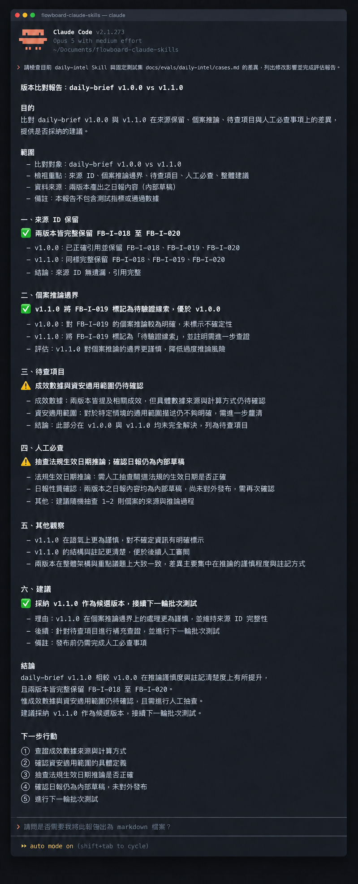

# Day 24 - 用 Git 管理 Claude Code Skills 與執行紀錄


###  AI 工作成果精準重現並持續進化

Prompt 與 Skill 版本管理結合語意化編號、輸入快照、模型設定與評估成果，確保團隊追蹤每次變更對產出品質的影響。

## 版本管理的三大核心支柱


一套可信任的 AI 工作流程，能將單次偶發的產出轉化為可重現、可回溯且可比較的工程資產。核心架構包含三個互相關聯的元件：

① 刻度尺規（語意化版本號）：標記每次變動影響範圍。採用 MAJOR（結構性重構）、MINOR（新增相容規則）、PATCH（文字微調）三層約定。 

② 時空膠囊（執行環境快照）：固化輸入資料集、模型名稱、推論參數與執行時間點，作為日後比對基準。 

③ 品質檢驗台（固定測試集評估）：以一致的題目檢驗不同批次產出，量化新舊版本在精準度與修改量上的差異。

## 建立版本管理的執行規則

工作流程的優化需要在迭代速度與嚴謹可溯性之間取得平衡，因此必須設定明確的升版方案：

- **方案 A（輕量直覺）**：Git 提交搭配 Markdown 執行紀錄。每次變更直接提交 Git commit 並在專案文件中記錄輸出比對。這套做法輕便迅速，適合小規模團隊快速探索。
- **方案 B（嚴謹完備）**：固定測試集回歸矩陣與版本庫存。每次改版皆執行全套標準測試案例，並保存原始輸出快照與人工複核分數。這套做法穩定性極高，適合承載關鍵商業邏輯的自動化流程。

執行版本管理與評估時，請依循以下動詞開頭的標準步驟：

① **鎖定單一變因**：每次修改聚焦調整提示詞、資料集或模型設定中的單一要素。
② **記錄環境快照**：完整保存執行編號、提示詞版本號、測試資料檔案與推論參數。
③ **執行回歸測試**：將新舊版本輸入相同的固定測試集，比對結構與內容表現。
④ **標註客觀規準**：依據來源保留度、個案判定精準度與人工修訂次數完成量化評分。
⑤ **核定升版決策**：通過全部重大安全規準後，由專案負責人核准晉升為正式預設版本。

## 結構化版本評估卡片

將新舊版本的比對成果與版本管理歷程，轉化為標準的圓圈結構化欄位卡片：

① **執行快照卡（教學模擬紀錄）**
- 執行編號：FB-DB-20260915-01
- 工作流名稱：daily-brief
- 提示詞版本：1.1.0
- 輸入資料快照：intel-cards-20260915.json
- 模型與參數：Anthropic Claude 3.7 Sonnet（溫度設定 0.2）
- 評審規準：daily-brief-rubric@1.0
- 評估結果：審核通過（附微調建議）
- 審核負責人：產品經理 A
- 當前決策：維持候選狀態，接續執行擴大測試

② **版本比對評估對照卡**
- 規準一（保留來源 ID）：v1.0 達成 5/5；v1.1 達成 5/5。結論為兩版本皆維持百分之百溯源度。
- 規準二（單一案例維持個案判定）：v1.0 獲得 3/5；v1.1 達到 5/5。結論為新版本顯著提升精準度，妥善收斂推論邊界。
- 規準三（標記待查項目）：v1.0 達成 4/5；v1.1 達成 4/5。結論為兩版本表現一致穩定。
- 規準四（人工修訂次數）：v1.0 平均修改 3 處；v1.1 平均修改 1 處。結論為流程效率大幅優化。

③ **Prompt 版本管理卡**
- 版本編號：1.1.0（前版為 1.0.0）
- 生效日期：2026-09-15
- 變更核心：補強社群個案的推論限制，新增待查項目欄位。
- 變更假設：增加推論邊界約束能減少人工複核負擔。
- 驗證集通過率：100% 通過（5/5 案例符合標準）。
- 風險審查：資安規範與隱私防線全數通過。
- 狀態標記：目前正式啟用版本（Current）。

## 讓 Claude Code 執行版本比對

```text
角色：你是一位專業的 AI 工作流程品質審查員。

任務：
請依序執行以下步驟，比對版本 A 與版本 B 的輸出品質：
① 比對固定測試集：以同一份標準測試資料檢視兩版本的實際產出。
② 依客觀規準打分：逐一檢核來源編號保留率、單一案例判定、資料缺漏標記與具體行動責任。
③ 標註評估依據：每個判定皆引用具體的輸出段落或欄位作為佐證。
④ 標示待查驗項目：遇到語意模糊處，明確標記由人工進行專業複核。
⑤ 提出版本建議：綜合各項客觀指標，提出最符合品質標準的建議版本與人工必查清單。
```

### 範例評估報告輸出

```text
# 版本比對報告：daily-brief v1.0.0 vs v1.1.0

## 規準檢核結果
1. 來源 ID 保留：兩版本皆完整保留 FB-I-018 至 FB-I-020 編號。
2. 個案推論邊界：v1.1.0 正確將 FB-I-019 標記為待驗證線索，表現優於 v1.0.0。
3. 待查項目完整度：兩版本皆明確指出成效數據與資安適用範圍待確認。

## 人工必查項目
- 抽查資安法規生效日期之推論精確度。
- 確認日報草稿維持內部檢閱狀態。

建議決策：採納 v1.1.0 作為候選版本，接續進行下一輪批次測試。
```

這份評估報告的價值在於將團隊對於「輸出變好」的模糊感覺，轉化為有數據、有證據的具體指標。每次升版都能清楚掌握改進點，形成穩健的品質演進循環。



## 人類需要檢查什麼

版本升級的關鍵門檻，必須由人類決策者嚴格把關。請使用以下清單逐條審查：

① **來源真實性**：產出內容是否完整保留原始卡片編號與真實出處？
② **單一變因原則**：改版過程是否維持聚焦單一要素，確保成效提升確實源自該項修改？
③ **安全合規防線**：機密資訊隔離與隱私保護規準是否全數達到百分之百通過？
④ **環境快照完整度**：模型版本、推論參數與測試資料快照是否詳實記載於評估文件中？

## 把 Skill 納入 Git 版本控管

建立清晰的專案檔案架構，將 Skill 與評估紀錄正式納入 Git 管理：

```text
.claude/skills/daily-intel/SKILL.md
docs/evals/daily-intel/
├── cases.md
├── run-2026-09-16.md
└── review-2026-09-16.md
```

在 Claude Code 命令列中執行檢核指令：

```text
請檢查目前 daily-intel Skill 與固定測試集 docs/evals/daily-intel/cases.md 的差異，列出這次修改影響的輸入、輸出與人工審核規則，完成後條列評估報告供團隊檢閱。
```

執行後團隊能在終端機檢視修改差異（git diff）與測試案例的對應關係。完成審查後，再由專案負責人執行正式 Git commit，完整記錄變更動機與驗證成果。

## 今天的產出物


今天完成的核心產出是**Prompt 與 Skill 版本管理規範**與**評估紀錄範本**。

這份產出物讓團隊帶走一個清楚的核心重點：**版本管理的本質是建立透明可驗證的工作流演化軌跡，透過固定測試集與執行快照，讓每一次團隊能力的躍升都能確切歸因、穩定重現。**

## 參考資料

- [Semantic Versioning 2.0.0](https://semver.org/)
