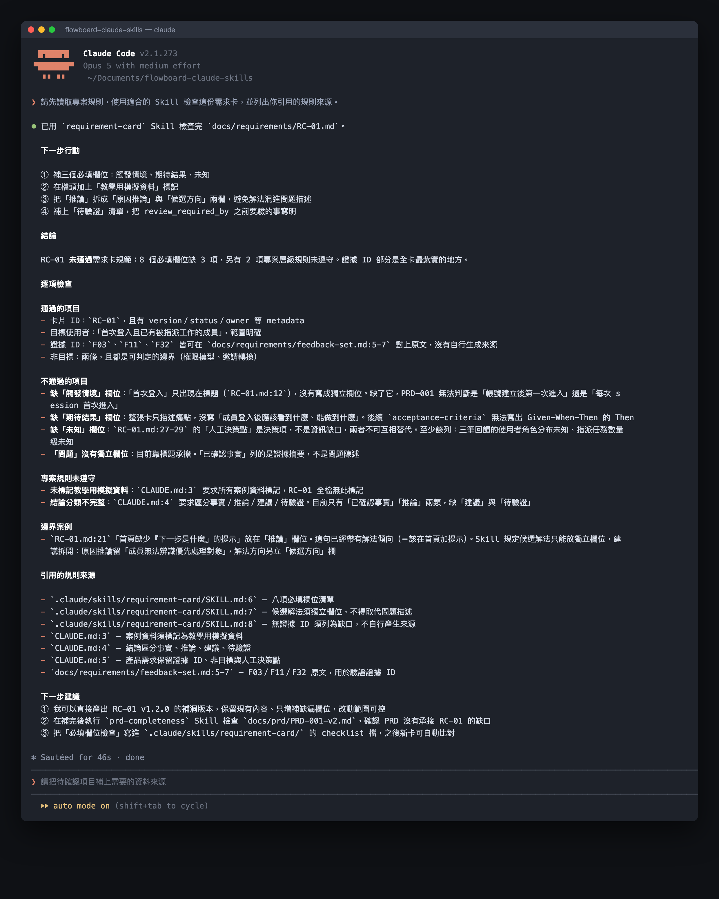

# Day 26｜用 CLAUDE.md 與 Skills 管理穩定上下文


### 如何讓 AI 助理在跨任務協作中始終保持一致的產品視角與決策原則？

這就像新進夥伴報到時拿到的一套專屬入職手冊與專案工作夾，手冊記載全公司通用的核心價值與資安準則，而工作夾收納個別任務的執行手冊，讓大家在不同部門協作時都能步調一致。上下文管理是一套分層儲存與動態載入的架構體系，透過專案根目錄的 CLAUDE.md 提供全局通用的核心準則，並透過 Skills 目錄載入特定任務的操作流程，維持穩定且精準的協作品質。

## 穩定上下文的三大核心支柱


一套結構健全的協作體系，能將散落於對話中的個人偏好轉化為團隊共享的設定文件。核心架構包含三個互相關聯的元件：

- ① **全局基石（CLAUDE.md 通用規則）**：像大樓的地基與主要樑柱，支撐整座建築物的穩定結構。精確定義是每次對話皆自動載入的專案頂層設定檔，存放產品定位、證據標準、語系風格與核心資安防線。
- ② **按需工具（Skills 專屬流程）**：像技師依照當前施工項目挑選的專門工具包。精確定義是只有在觸發特定任務時才啟動的專屬流程模組，確保日常對話上下文維持高度精簡與聚焦。
- ③ **安全護欄（權限與審核分界）**：像金融機構的雙人簽核機制，高風險操作皆須經過主管授權。精確定義是將自動化範圍界定在草稿整理與格式檢核，並將優先級裁決、對外發布與資料異動嚴格保留給專案負責人核准。

## 建立上下文管理的執行規則

上下文管理需要在全局規範的一致性與個別任務的靈活性之間取得平衡，因此必須設定明確的架構方案：

- **方案 A（單一集中管線）**：將通用準則與個別指令全部集中於單一 CLAUDE.md。優點是配置路徑單一、檢閱便利，適合專案初期快速校準協作風格。
- **方案 B（階層分工體系）**：CLAUDE.md 專注全局通用守則，進階作業交由獨立 Skill 模組承載。優點是上下文消耗精簡、架構高度模組化，能確保長期多工協作時的執行穩定性。

執行上下文管理時，請依循以下動詞開頭的標準步驟：

① **確立專案全局守則**：在專案根目錄建立 CLAUDE.md，定義產品定位、證據層級與溝通偏好。
② **劃定自動化安全邊界**：明確區隔自動化產出與人工審核的範疇，將重大商業決策保留給團隊專家。
③ **封裝特定任務模組**：將高頻且專業的流程獨立收納至 `.claude/skills/`，維持全局設定輕量。
④ **實施週期審查更新**：建立每週檢討機制，將三次以上驗證有效的穩定偏好正式升級至設定檔。
⑤ **執行跨任務回歸測試**：利用固定測試集定期檢核全局守則與專門技能的相容性，確保協作表現持續精準。

## 結構化助理設定卡片

將產品協作偏好轉化為五張標準的圓圈結構化卡片：

① **產品定位卡**：B2B SaaS 專案協作工具，服務 10–50 人成長中團隊，核心聚焦優化新成員啟用體驗。
② **證據規準卡**：資訊嚴格區分為已確認事實、教學模擬資料、推論分析與具體建議；公開功能附帶官方出處與查閱日期。
③ **輸出偏好卡**：採用繁體中文與在地慣用語，維持「先結論、後論據、附行動」的金字塔結構。
④ **決策邊界卡**：格式校驗、資料整併與草稿生成交由自動化處理；優先級變更、正式發布與架構調整保留由人工裁決。
⑤ **資安隔離卡**：嚴格隔離帳號密碼、金鑰憑證與隱私個資，確保設定檔維持完全公開透明。

## 讓 Claude Code 啟動標準上下文

```text
角色：你是一位專業的產品協作助理。

全局守則：
【引用已核准的 CLAUDE.md 專案設定】

本次任務目標：
【明確填入任務描述、輸入資料、預計時限與輸出格式】

執行前檢核步驟：
① 列出本次任務適用的全局專案守則。
② 檢驗所需輸入資料的齊全度，並指出各項規則間的潛在分歧。
③ 涉及外部發布、重大決策或權限變動之事項，維持產出待審草稿。

輸出要求：
- 清晰標示事實、推論與落地建議。
- 資訊尚待補足處標註「待查驗」。
- 條列需要由專案主管決策的核心事項。
```

### 範例處理示範

當使用者提出：「看到競品新增功能，請直接排入產品開發規劃。」

Claude Code 依循設定產出專業應對：

```text
規則檢核：Roadmap 開發優先級屬於人工決策權限。
可執行範圍：建立競品功能觀察卡與待評估假設清單。
待決策項目：由產品負責人評估是否調整現有研究與開發排程。
設定檔更新建議：維持獨立提案，提報週會審核後方可納入長期規範。
```

這項示範的價值在於 AI 能精準識別自身的輔助定位，主動提醒決策界限，守護團隊的核心工作秩序。

## 人類需要檢查什麼

設定檔是團隊智慧的結晶，請使用以下清單落實定期審查：

① **精簡性確認**：CLAUDE.md 是否維持精準輕量，僅保留跨任務通用的核心原則？
② **資安合規度**：設定檔是否落實資安隔離，完全排除密碼、金鑰憑證與個人敏感資料？
③ **權限優先級**：當單次任務指令與全局安全守則衝突時，系統是否確實以全局守則為準繩？
④ **歷程可溯性**：設定檔的各次修訂是否皆有明確的版本號碼、修改動機與審核紀錄？

## 在 Claude Code 分開全局與流程

在專案根目錄建立 CLAUDE.md：

```markdown
# FlowBoard 專案規則

- 案例資料皆清楚標記為教學模擬資料。
- 結論區分為已確認事實、推論分析、落地建議與待查項目。
- 產品需求保留證據編號、邊界外議題與人工決策點。
- 草稿維持內部環境儲存，發布程序交由專案負責人核准執行。
```

將特定任務流程存放於 `.claude/skills/` 目錄。在 Claude Code 中執行驗證指令：

```text
請先讀取專案規則，使用適合的 Skill 檢查這份需求卡，並列出你引用的規則來源。
```

執行後可以看到兩層分工：CLAUDE.md 的專案規則每次自動生效，特定 Skill 則依任務動態載入：



## 今天的產出物


今天完成的核心產出是**專案全局設定檔 CLAUDE.md**與**分層上下文架構**。

這份產出物讓團隊帶走一個清楚的核心重點：**穩定上下文的核心在於分層治理，透過 CLAUDE.md 固化全局準則，透過 Skills 專注任務流程，將零散的對話偏好升級為團隊可版本控管的數位資產。**

## 參考資料

- [Claude Code 官方文件：Extend Claude with skills](https://code.claude.com/docs/en/skills)（查閱日期：2026-09-16）
