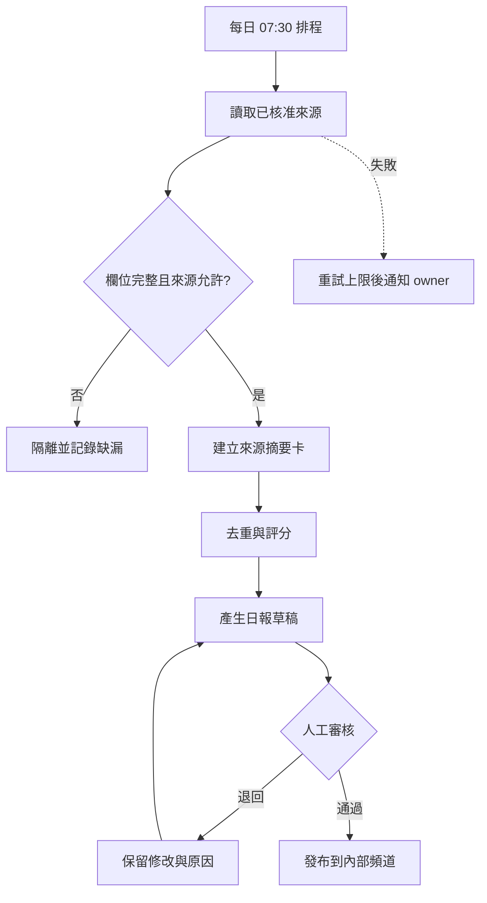

# Day 27｜從單次對話到自動化流程


每天早上，FlowBoard 產品經理都會貼情報卡、執行日報 Skill、複製結果，再提醒同事審核。步驟已經穩定，卻仍靠一個人記得操作。今天要把它畫成能交給系統執行、也能被人中止的流程。

## 自動化的核心是狀態與責任

單次 Prompt 只有輸入與輸出；工作流還要處理觸發、資料驗證、重試、重複執行、權限、人工核准、紀錄和失敗通知。Agent 則通常能依目標與目前狀態選擇工具或下一步。三者可組合，但不要把任何「呼叫模型」都稱為 Agent。

截至 2026-09-15，OpenAI 官方 Agents API 把 Agent 描述為專案範圍內可重用的 agent，並提供 session、turn、subagent 與 environment 等資源；這是具體平台能力，不是所有自動化工具的共同定義。[官方 Agents API](https://developers.openai.com/api/reference/python/resources/beta/subresources/agents)

判斷是否適合自動化，可看四項條件：輸入格式是否穩定、成功標準是否可檢查、錯誤是否可逆、頻率是否足以抵銷維護成本。需求優先級、對外承諾和不可逆資料操作仍應保留人工決策。

## FlowBoard 日報流程圖


以下均為教學用模擬設計：



每個節點都應有輸入、輸出與狀態。例如來源摘要不是一段自由文字，而是一筆包含 `source_url`、`published_at`、`facts`、`uncertainties` 的資料。`run_id` 貫穿全程，才能追查某份日報使用了哪些來源、哪版 Skill 與哪次人工修改。

## 可複製的流程定義表

```text
流程名稱：FlowBoard Daily Intel
觸發：工作日 07:30 Asia/Taipei
輸入：核准來源清單、上次成功時間、助理設定檔版本

步驟 1 收集
- 成功：取得內容、網址與發布時間
- 失敗：最多重試 2 次，仍失敗就記錄並通知

步驟 2 驗證
- 必填：來源、網址、發布/查閱日期
- 不合格：隔離，不送模型

步驟 3 摘要與去重
- Skill 版本：flowboard-daily-intel@1.0.0
- 輸出：情報卡與缺漏清單

步驟 4 人工核准
- 核准人：當值 PM
- 逾時：不發布，發提醒

步驟 5 發布
- 僅能發內部指定頻道
- 保存 run_id、版本、核准人與時間

停止條件：來源暴增、敏感資料、來源衝突、成本超過上限
```

## 用 Prompt 產生流程草稿

```text
角色：你是工作流設計審查員。
背景：【貼上產品背景、助理設定檔與既有 Skill】
任務：把人工操作拆成觸發、驗證、處理、審核、發布與監控節點。
輸入：【逐步描述目前人工流程】
限制：
- 不假設平台具有未提供的連接器或記憶。
- 資料刪除、權限變更、付款、對外發布需人工核准。
- 每個外部寫入動作都要有冪等鍵或重複執行防護。
- 列出失敗、逾時、重試上限與通知對象。
輸出：流程圖、節點契約、權限表、失敗表、人工關卡、待確認能力。
```

冪等是容易漏掉的一點：排程逾時重跑時，不應重複寄出兩份日報。可以用 `日期＋流程版本` 作為發布鍵，在寫入前檢查是否已成功完成。

## 人類需要決定什麼

先決定自動化邊界，再選工具。團隊要確認資料能否送到模型或第三方服務、密鑰如何管理、誰有發布權、失敗通知由誰接手。也要設定成本與數量上限，防止來源頁面異常或迴圈造成大量呼叫。

別把「無人值守」理解成「無人負責」。每條正式流程都需要 owner、服務水準、暫停開關、操作紀錄與復原方式。

## 今天的產出物


畫出你的 AI 自動化流程圖，並補齊節點契約、人工關卡、停止條件、重試與去重策略。明天會把這張圖部署到一個平台中立的 24/7 執行架構，加入排程器、秘密管理、監控與告警。

## 參考資料

- [OpenAI API Reference：Agents](https://developers.openai.com/api/reference/python/resources/beta/subresources/agents)（查閱日期：2026-09-15）
