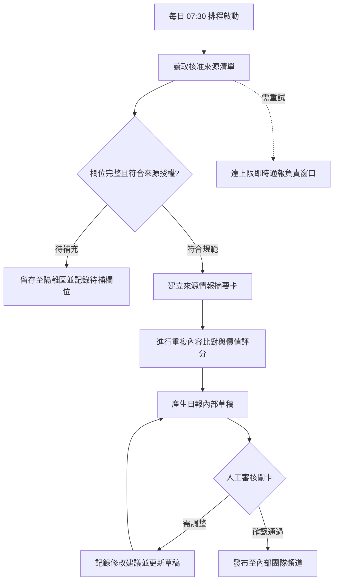
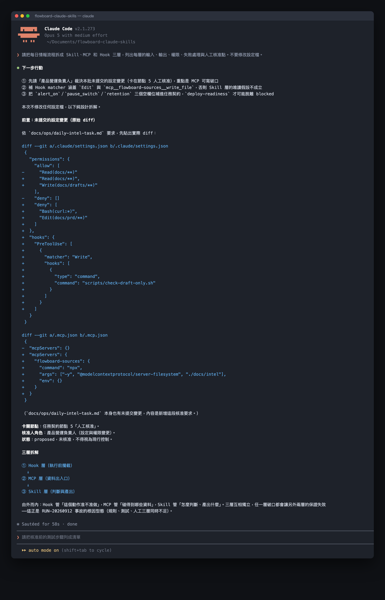
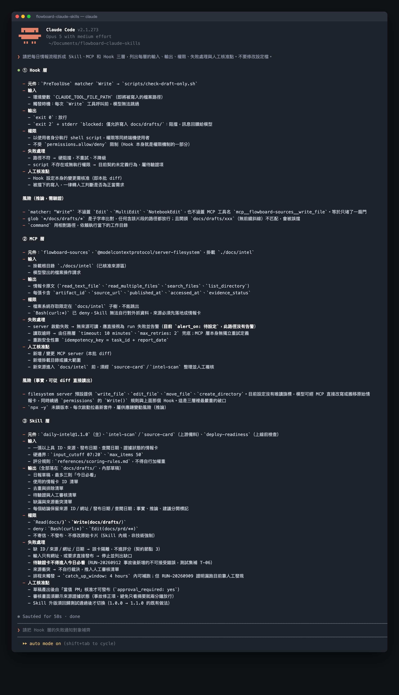

# Day 27｜用 Claude Code Hooks 與 MCP 串起工作流


### 如何讓每天例行的情報整理工作自動且穩定地交接？

每天早晨，團隊都期待看見最新、最乾淨的競品動態與市場情報。這就像給家裡裝上一條全自動的積木輸送帶，玩具箱會把散落各處的積木倒在傳送帶上，經過感應器檢查顏色，再由機器手臂排成整齊方塊，最後等待你親自點頭才放進展示櫃。在軟體開發中，這條輸送帶就是「自動化工作流程」：由系統排程定時啟動，依循固定規則呼叫外部工具收集資料，並在關鍵決策點保留人工核准關卡的程式化執行管道。

## 自動化的核心是狀態與責任

單次對話提供即時解答，工作流程則進一步管理狀態演進與跨系統責任。一條健康的自動化管道，需要妥善配置觸發時機、資料檢核、重試機制、重複防護、權限邊界、人工審核、執行履歷與異常通報。

在 Claude Code 的架構中，三個關鍵元件各司其職：
- **Skill（規則說明書）**：像烘焙蛋糕的食譜卡，它是指導模型進行格式轉換、重點歸納與邏輯推論的結構化提示詞指令集。
- **MCP（工具連線插座）**：像牆壁上的多功能插座，它是讓程式安全讀取外部授權網頁、專案管理系統或資料庫的標準化通訊協議。
- **Hooks（安全警衛鈴）**：像玄關的自動感應鈴，它是當特定操作事件發生時，由系統本機環境立刻執行的確定性指令與安全檢查防線。

將三者妥善組合，並由團隊在關鍵樞紐設置人工簽核點，即可建立兼顧產能與安全邊界的高效率系統。

## 做法與權衡

原因：團隊需要考量自動化深度與系統安全邊界，選擇最符合現階段維護成本的串接架構。

- **方案 A：輕量受控腳本（簡單有效，適合快速驗證）**：由人工手動執行指令觸發 Skill 產出情報草稿，並在終端機介面中進行確認，花費極少設定時間即可達成日常摘要輔助。
- **方案 B：三層安全聯防架構（高效有用，適合穩定營運）**：同時配置 Skill 處理摘要、MCP 讀取受信任來源，以及 Hooks 執行合規檢查與審核阻擋，在擴大產能的同時建立嚴密的安全防護網。

## FlowBoard 日報流程圖


以下展示教學情境的標準安全工作流程：



每個處理節點皆具備清晰的輸入、輸出與狀態定義。來源摘要是一組結構化資料，包含來源網址、發布時間、客觀事實與待查項目。系統全程附帶唯一執行序號（run_id），確保日後隨時追溯資訊產生的完整歷程。

## 執行規則

① 盤點輸入來源：確認每一筆來源資訊具備合法授權網址、發布時間戳記與完整標題。
② 鎖定存取權限：配置 MCP 工具維持唯讀權限，隔離對外寫入與資料庫異動能力。
③ 部署審核閘門：設定所有對外發布與跨系統發送動作必須取得人工核准。
④ 指派負責角色：為每個節點指定明確的維護團隊與異常應變負責窗口。

## 結構化示範

以下為 FlowBoard 每日情報流程的卡片結構示範：

① **節點 1：來源收集與格式檢核卡片**
- 觸發時機：每週工作日上午 07:30
- 輸入規範：核准來源清單、前次成功執行記錄
- 處理標準：資料完整即推進下一步；資料留有待補欄位即移至隔離檢視區

② **節點 2：智慧摘要與卡片建立卡片**
- 執行工具：Skill（flowboard-daily-intel@1.0.0）
- 產出項目：標準情報卡片、核心事實與待查項目清單
- 運作限制：純文字資訊萃取，保持資料環境唯讀狀態

③ **節點 3：人工審核與授權發布卡片**
- 審核負責角色：當值產品營運經理
- 驗證準則：逐筆核對摘要內容與原始來源連結
- 發布權限：通過審核後傳送至內部指定溝通頻道，落實內部傳閱原則

## 用 Prompt 產生流程草稿

```text
角色：工作流程架構顧問

任務：
① 梳理目前人工處理步驟，標示觸發、驗證、摘要、審核與發布節點。
② 訂定每個節點的輸入格式、產出規格與流轉條件。
③ 為所有資料變更與發布步驟設置人工核准卡點。
④ 指定每個節點的負責窗口與重試次數上限。

規範：
- 嚴格遵守最小權限配置，保持唯讀資料連線。
- 確保所有輸出保留唯一執行識別碼（run_id）以供隨時溯源。
- 將推論觀點與客觀事實明確區隔標示。

輸出：
A. 節點契約清單：節點名稱、負責角色、輸入資料、輸出項目
B. 權限邊界規範：工具名稱、操作範圍、阻擋條件
C. 人工審核檢查項目：核對依據、簽核流程、逾時通報
```

### 範例輸出與核心價值

```text
執行識別碼：RUN-20260920-01
處理狀態：已產出內部草稿，留待人工審核
來源依據：核准名單編號 INT-008、INT-012
待查項目：新版本支援之特定語言清單需進一步確認官方手冊
審核人員：當值產品營運經理
重複執行保護鍵：daily-intel-20260920
```

這段設計的核心價值在於建立「確定性」：讓電腦高效執行資料爬取與整理，讓人腦牢牢掌握內容真實度與最終發布權。

## 人類需要檢查什麼

- 確認外部資料讀取工具維持受限的唯讀權限。
- 檢驗情報卡事實確實附帶正確的來源連結。
- 測試系統逾時狀況能即時通知指定負責人。
- 驗證發布動作確實需要經過專人簽核確認。
- 檢查重複執行防護鍵生效以確保單日僅產出一份正式紀錄。

## 把規則封裝成 Claude Code Skill

專案目錄結構配置如下：

~~~text
.claude/skills/daily-intel/SKILL.md  # 日報整理推論規則
.mcp.json                            # 外部受信任資料連線配置
.claude/settings.json                # Hooks 與系統權限配置
~~~

在 `.claude/skills/daily-intel/SKILL.md` 寫入配置：

~~~markdown
---
name: daily-intel
description: 讀取授權來源並整理每日情報草稿，嚴格標記事實依據與待查項目，等待人工核准發布。
---

執行原則：
① 僅讀取授權名單內的來源資料。
② 為每條事實標記來源網址與查閱日期。
③ 將所有發布動作保持在待審草稿狀態，等待人工簽核。
~~~

執行指令：

~~~text
/daily-intel 請分析本週核准清單的最新更新，建立情報草稿，並列出待確認的技術細節。
~~~

同一次執行會先交代這批設定變更的來歷：原始 diff 照貼，並標明它停在任務契約的哪個人工核准節點、核准人是什麼角色，接著才畫出三層的順序：



下方呈現三層的配置細節，每層皆列出輸入、輸出、權限邊界、重試處理與人工核准點，明確區隔客觀事實與邏輯推論：



## 今天的產出物


今天完成的是**具備人工審核閘門的情報工作流藍圖**。

清楚的權限邊界與人工把關，永遠比全自動推進更能確保團隊的安全與信賴。這套設計讓例行整理自動運轉，同時保留完全的人類掌控權。

## 參考資料

- [Claude Code 官方文件：Extend Claude with skills](https://code.claude.com/docs/en/skills)（查閱日期：2026-09-16）
