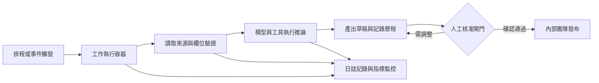
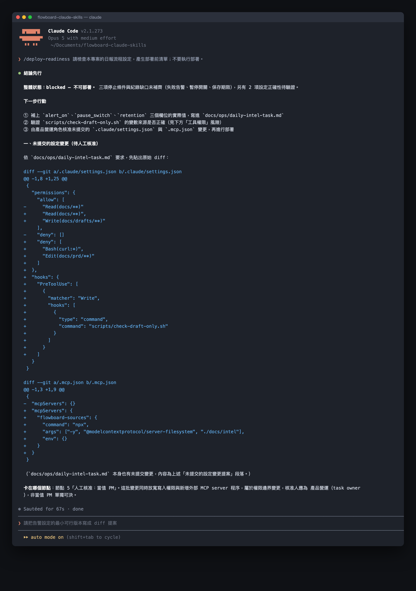
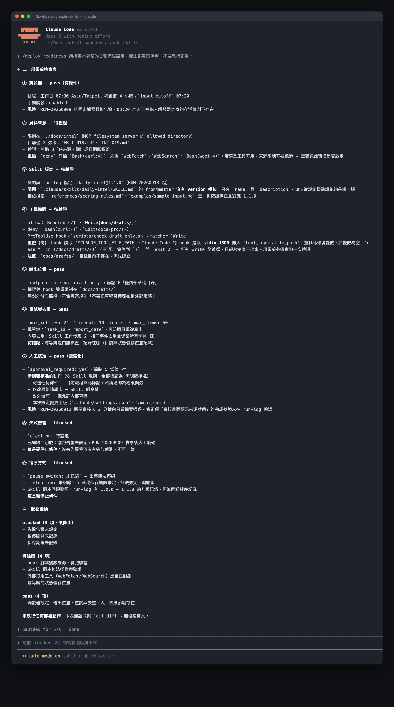

# Day 28｜部署可監控的 Claude Code 工作流


### 如何讓 AI 工作流程在電腦休眠時依然準時且可靠地運作？

每天早晨，團隊都期待最新情報準時送達工作頻道。這就像給花園裝設一套全自動灑水系統，水塔會依據定時器準確供水，水管感應水壓順暢噴灑，遇到管線壓力異常時會立刻亮起警示黃燈通知管理員。在軟體工程中，這套機制就是「可監控的自動化部署」：將 AI 任務託管在持續運行的受管環境中，依循排程定時啟動、記錄完整執行狀態，並在進度延宕時發出預警的可靠維運體系。

## 先選架構，再選產品

持續運行的核心在於建立穩定的執行環境與責任歸屬。一套完整的產品工作流，除了 AI 模型推論能力之外，更需要排程調度器、執行環境、資料來源、權限隔離、狀態儲存、人工審核介面與即時監控系統協同運作。

最小可用架構包含七個相互銜接的層級：
- **觸發器（Trigger）**：像定時鬧鐘，依據固定時區或外部事件啟動工作。
- **工作執行器（Runner）**：像獨立工作站，提供運算資源與安全的程式執行容器。
- **資料來源（Data）**：像專屬檔案櫃，提供經過驗證與授權的輸入清單與情報儲存區。
- **模型與工具（Model）**：像智慧助理，透過 API 接口執行結構化提煉與邏輯推論。
- **狀態儲存（State）**：像工作日誌簿，完整記錄每次執行的識別序號、版本與結果。
- **人工核准介面（Approval）**：像主管簽章卡，在關鍵發布前取得專人確認。
- **監控與告警（Monitoring）**：像儀表板與警報燈，即時觀測執行時間、成本用量並發送通知。



## 做法與權衡

原因：團隊需要根據維運資源與系統可靠度要求，選擇合適的持續運作架構。

- **方案 A：受管平台排程（簡單有效，適合輕量敏捷）**：運用現成雲端平台（例如 GitHub Actions）內建排程器，設定 cron 定期啟動工作，以最低維護成本達到定時產出。
- **方案 B：專屬事件驅動架構（高效有用，適合深厚穩定）**：建立具備獨立執行容器、集中式日誌管理與即時推播通報的伺服器架構，實現高度彈性的任務排程與即時補跑機制。

## FlowBoard 的部署清單


以下展示教學情境的七層部署規範：

① **第一層：觸發層配置卡片**
- 執行配置：每週工作日上午 07:30，Asia/Taipei 時區
- 驗收方式：測試手動排程觸發功能與自動補跑驗證

② **第二層：執行層配置卡片**
- 執行配置：受管雲端工作執行環境
- 驗收方式：記錄啟動時刻、結束時刻與完成狀態

③ **第三層：資料層配置卡片**
- 執行配置：核准情報來源清單與儲存區
- 驗收方式：僅接收具備完整發布日期與清晰來源之項目

④ **第四層：模型層配置卡片**
- 執行配置：支援結構化輸入之官方 API 接口
- 驗收方式：完整記錄模型版本與參數配置

⑤ **第五層：狀態層配置卡片**
- 執行配置：記錄執行序號（run_id）、卡片版本與 Skill 設定
- 驗收方式：確保能由最終報告反向溯源原始來源資料

⑥ **第六層：核准層配置卡片**
- 執行配置：當值產品經理審核內部草稿
- 驗收方式：具備審核通過簽章始得進行發布動作

⑦ **第七層：監控層配置卡片**
- 執行配置：排程逾時通報、中斷警報、用量上限與卡片數量管制
- 驗收方式：數值達預警門檻即時通知負責窗口

## 執行規則

① 鎖定時區排程：設定 Asia/Taipei 時區並保留手動執行按鈕，維持排程可調度性。
② 隔離金鑰機密：將 API 金鑰妥善存放在平台的秘密管理專區，隔離於程式碼與操作日誌之外。
③ 啟動平行測試：以 shadow mode 模式執行一週，系統產出內部草稿供人工比對品質。
④ 配置逾時補跑：設定在四小時彈性窗口內自動偵測延遲執行並啟動補跑程序。

## 結構化示範：任務契約

```text
任務代碼：flowboard-daily-intel
負責單位：Product Operations
排程設定：每週工作日 07:30 Asia/Taipei
手動觸發：已啟用
補跑窗口：4 小時以內
輸入截止：07:20
處理數量上限：50 篇
重試次數上限：2 次
執行逾時門檻：10 分鐘
重複防護識別碼：task_id + report_date
產出模式：僅限內部草稿
審核機制：強制人工核准
警報觸發條件：排程逾時、連續執行中斷、用量突增、成本達門檻
暫停開關：具備快速切換機制
保存政策：依據團隊標準規範儲存
```

## 用 Prompt 執行部署審查

```text
角色：AI 工作流可靠性與資訊安全審查員

輸入：
【流程圖、任務契約、平台官方能力清單、資料分類層級】

任務：
① 檢視整個流程鏈條，列出單點中斷、過度權限與重複執行之潛在狀況。
② 針對各項狀況設計明確的預防措施與即時偵測指標。
③ 為每個處理節點設定具體的人工負責窗口與對應復原方案。
④ 規劃上線前必須通過的功能驗收清單。

輸出：
A. 風險情境清單：情境描述、影響層級、預防機制、偵測方式
B. 復原應變手冊：處置步驟、負責窗口、完成時限
C. 上線前測試項目：測試案例、預期結果、驗收簽章
```

### 範例輸出與核心價值

```text
風險情境：排程逾時啟動
預防機制：避開整點尖峰時段；保留手動觸發通道
偵測方式：當日上午 08:00 系統檢查當日 run_id，留有空缺即刻發送告警
復原方案：在四小時補跑窗口內由負責人啟動手動補跑程序
負責窗口：Product Operations
```

這項審查的核心價值在於建立「系統彈性」：承認雲端環境具有波動性，提早準備好預警與應變機制，讓自動化流程兼具速度與穩定度。

## 人類需要檢查什麼

- 確認服務授權條款與資料儲存區域符合組織合規標準。
- 檢視 API 金鑰妥善存放在受保護的密鑰管理庫。
- 測試系統排程延遲啟動時能在指定時間內發送告警。
- 確認當值人員清楚掌握手動補跑與暫停開關操作方式。
- 檢驗審核草稿界面清晰呈現來源依據以利快速查驗。

## 把規則封裝成 Claude Code Skill

專案目錄結構配置如下：

~~~text
.claude/skills/deploy-readiness/SKILL.md  # 部署就緒檢查推論規則
~~~

在 `.claude/skills/deploy-readiness/SKILL.md` 寫入配置：

~~~markdown
---
name: deploy-readiness
description: 檢查產品情報工作流是否具備來源限制、權限隔離、重試機制、人工核准、執行日誌與即時告警，完成檢查後產出部署審核清單。
---

執行原則：
① 檢核資料來源是否僅限授權名單。
② 確認涉及發布與資料變更之動作皆設有人工審核卡點。
③ 標記所有待補齊的告警設定與暫停機制，確保上線前具備完整安全防護。
~~~

執行指令：

~~~text
/deploy-readiness 請檢查本專案的日報流程設定，產生部署前清單；請維持檢核狀態，留待後續審查。
~~~

執行時系統會先將待確認的設定變更展開，清晰交代這批變更停在任務契約的哪個審核節點：



接著呈現完整的檢查表，逐項給出檢核狀態，明確標示告警與復原機制的待完善項目，協助團隊鎖定關鍵防護重點：



## 今天的產出物


今天完成的是**可監控的 24/7 AI 助理任務部署清單**。

穩定的自動化體系是在任何時刻皆具備明確的負責人、透明的運作狀態，以及完善的預警與補跑機制。這份清單確保團隊在享受自動化便利的同時，牢牢維持系統的主導權。

## 參考資料

- [Claude Code 官方文件：Extend Claude with skills](https://code.claude.com/docs/en/skills)（查閱日期：2026-09-16）
- [Claude Code 官方文件：Hooks reference](https://code.claude.com/docs/en/hooks)（查閱日期：2026-09-16）
- [GitHub Actions：Workflow syntax](https://docs.github.com/en/actions/reference/workflows-and-actions/workflow-syntax)（查閱日期：2026-09-15）
- [GitHub Docs：Scheduling issue creation](https://docs.github.com/en/actions/tutorials/manage-your-work/schedule-issue-creation)（查閱日期：2026-09-15）
