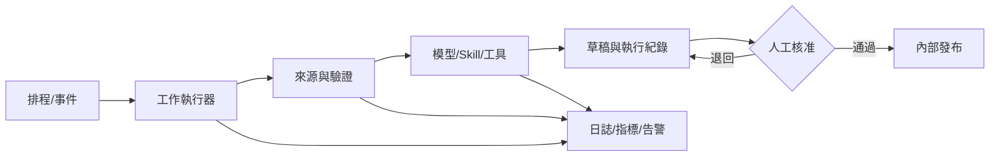

# Day 28｜部署你的 24/7 AI 助理

FlowBoard 的流程圖已完成，但筆電闔上後，早上七點半的任務不會自己執行。所謂 24/7 助理，不是模型永遠醒著，而是有一套持續可用的執行環境，在事件或排程到達時啟動工作，並在失敗時留下訊號。

## 先選架構，再選產品

正式大綱提到 OpenClaw。查核其[官方文件](https://docs.openclaw.ai/)與[官方 GitHub 專案](https://github.com/openclaw/openclaw)後，截至 2026-09-15，可以確認它是可在自有設備或基礎設施運行的開源 AI 助理，核心是 Gateway，提供對話渠道與相關工具設定。這不代表 FlowBoard 的日報流程只要安裝 OpenClaw 就能完成：來源接入、核准、重試與監控仍要依具體部署設定驗證。本文先用平台中立架構說明必備元件，再讓讀者依組織現況評估 OpenClaw、雲端排程、CI 工作流、自動化平台或自架服務。

一套最小可用架構包含七層：觸發器、工作執行器、資料來源、模型或工具、狀態儲存、人工核准介面、監控告警。模型只占其中一層。

選型時可問三件事：執行器是否能在你的設備停機時仍運作？是否能限制來源、工具與寫入權限？是否具備可回查的執行紀錄、失敗告警及人工核准接口？OpenClaw 的官方快速入門描述了安裝、設定模型存取和啟動 Gateway 的起點；這只能證明可以啟動助理，不能代替上述流程驗收。[OpenClaw 官方快速入門](https://docs.openclaw.ai/quickstart)



排程服務也不是精準鬧鐘。以 GitHub Actions 為例，官方文件說明可用 POSIX cron 設定 `schedule`，並可指定 IANA 時區；排程工作跑在預設分支的最新提交。[GitHub Actions workflow syntax](https://docs.github.com/en/actions/reference/workflows-and-actions/workflow-syntax) 官方教學也提醒，高負載時排程可能延遲，甚至有佇列工作被捨棄的情況，因此關鍵任務要有補跑和漏跑偵測，不能只相信 cron。[GitHub 排程教學](https://docs.github.com/en/actions/tutorials/manage-your-work/schedule-issue-creation)

## FlowBoard 的部署清單

以下均為教學用模擬設計。第一版只部署「情報日報草稿」，不自動改 PRD、不更動 Roadmap，也不對外發布。

| 層 | FlowBoard 選擇 | 驗收方式 |
|---|---|---|
| 觸發 | 工作日 07:30，Asia/Taipei | 測試手動觸發與補跑 |
| 執行 | 受管工作執行器 | 紀錄開始、結束、狀態 |
| 資料 | 核准來源與情報卡儲存區 | 拒絕缺日期或來源項目 |
| 模型 | 支援所需輸入的 API | 記錄實際模型與設定 |
| 狀態 | run、卡片、Skill 版本 | 能從日報回查原文 |
| 核准 | 當值 PM 審核草稿 | 未核准不得發布 |
| 監控 | 漏跑、失敗、成本、數量 | 超過門檻通知 owner |

密鑰放在平台的秘密管理功能，不寫進 Prompt、程式碼或日誌。執行身分只取得讀取核准來源、寫入草稿與發送審核通知的權限；正式發布使用另一個受核准步驟控制的身分。

## 24/7 任務契約

```text
task_id: flowboard-daily-intel
owner: Product Operations
schedule: 工作日 07:30 Asia/Taipei
manual_trigger: enabled
catch_up_window: 4 hours
input_cutoff: 07:20
max_items: 50
max_retries: 2
timeout: 10 minutes
idempotency_key: task_id + report_date
output: internal draft only
approval_required: yes
alert_on: missed_run, repeated_failure, item_spike, cost_limit, source_conflict
pause_switch: documented
retention: 依組織政策填寫
```

上線順序採 shadow mode：第一週自動產草稿，但不發布，和人工版比較；第二週通過人工核准才發內部頻道；穩定後才評估降低審核頻率。任何重大規則或模型變更，都回到 shadow mode。

## 可複製的部署審查 Prompt

```text
角色：你是 AI 工作流的可靠性與資安審查員。
輸入：【流程圖、任務契約、平台官方能力、資料分類】
任務：找出單點故障、過度權限、重複執行、漏跑、成本失控與資料外洩風險。
限制：
- 只根據已提供的官方能力，不補造平台功能。
- 將每個風險連到可測試的控制措施。
- 不把「人工審核」當成沒有負責人與期限的萬用答案。
輸出：風險｜觸發情境｜影響｜預防｜偵測｜復原｜負責人｜上線前測試
```

範例輸出：

```text
風險：排程漏跑
預防：避開整點；保留手動觸發
偵測：08:00 仍無當日 run_id 即告警
復原：在四小時補跑窗內手動執行
負責人：Product Operations
```

## 人類要做的上線判斷

人要確認服務條款、資料位置、保存期限、費用與速率限制，並實測中止、回復與密鑰輪替。若使用 OpenAI API 的背景模式，官方文件指出它為了輪詢會暫時把回應資料寫入磁碟，且資料控制條件會受 `store` 與組織設定影響；不能只看到「background」便當成通用排程器或零保存方案。[OpenAI Data controls](https://developers.openai.com/api/docs/guides/your-data)

## 今天的產出物

完成 24/7 AI 助理任務清單：每項任務寫明 owner、觸發、輸入、輸出、權限、核准、成本上限、重試、漏跑偵測、暫停與復原。FlowBoard 第一版只有情報日報草稿；其他任務先留在人工流程。

明天會把前 28 天的產出完整串接，追蹤同一個 FlowBoard 啟用問題如何從情報與回饋走到需求、PRD、Demo、數據，再回到下一輪決策。

## 參考資料

- [OpenClaw 官方文件](https://docs.openclaw.ai/)（查閱日期：2026-09-15）
- [OpenClaw 官方 GitHub 專案](https://github.com/openclaw/openclaw)（查閱日期：2026-09-15）
- [OpenClaw 官方快速入門](https://docs.openclaw.ai/quickstart)（查閱日期：2026-09-15）
- [GitHub Actions：Workflow syntax](https://docs.github.com/en/actions/reference/workflows-and-actions/workflow-syntax)（查閱日期：2026-09-15）
- [GitHub Docs：Scheduling issue creation](https://docs.github.com/en/actions/tutorials/manage-your-work/schedule-issue-creation)（查閱日期：2026-09-15）
- [OpenAI API：Data controls](https://developers.openai.com/api/docs/guides/your-data)（查閱日期：2026-09-15）
