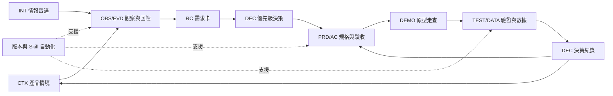
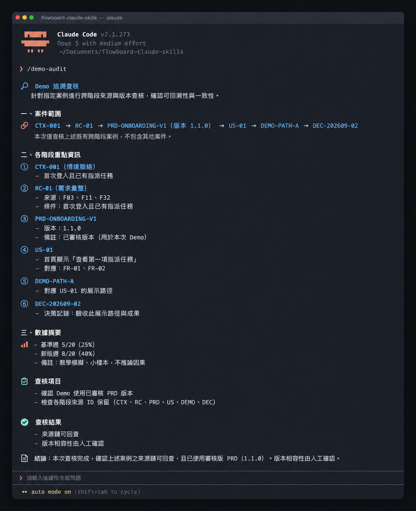

# Day 29｜把前 28 天組合成 Claude Code 產品工作流


### 如何讓產品從最初的靈感發想到最終的決策驗證，形成環環相扣的完整鏈條？

當團隊完成競品拆解、需求分析、規格書、原型展示與數據解讀時，往往累積了許多優秀的文件。這就像一串堅固的登山安全扣鏈，每一個環節都雕刻著專屬編號，彼此緊密扣合，只要檢視其中一個環節，就能清晰追溯整條繩索通往哪座山峰。在軟體產品開發中，這串扣鏈就是「產品證據鏈」：透過結構化代碼、版本控制與交接契約，將產品情境、競品觀察、用戶回饋、需求卡、規格書、原型走查與數據分析緊密串接的決策閉環體系。

## 串接的核心在於證據與決策

串接工作流的核心重點在於貫穿各階段的證據與決策鏈條。每一個步驟的產出，都會成為下一個步驟的關鍵輸入；每一次規格的調整，都能回溯到對應的用戶回饋與驗收紀錄。

一套完整的產品工作流包含六大核心階段：
- **產品情境（CTX）**：像地圖上的起點座標，它是定義團隊目標、使用客群與核心挑戰的基礎背景。
- **觀察與回饋（OBS / EVD）**：像現場收集的錄音與照片，它是記錄畫面上客觀元素與使用者具體反應的第一手資料。
- **需求卡（RC）**：像精準的採購清單，它是從多筆回饋中提煉出待滿足的使用者核心訴求。
- **功能規格（PRD / AC）**：像樂高積木的組裝說明書，它是定義介面在特定條件下應呈現之狀態與驗收準則。
- **原型走查（DEMO）**：像實體樣品模型，它是將抽象規格轉化為可實際操作與驗證的路徑載體。
- **決策紀錄（DEC / TEST）**：像科學實驗的正式結案報告，它是根據實測數據做出的具體決策與迭代方向。



## 做法與權衡

原因：團隊需要考量專案複雜度與追溯嚴謹度，選擇最適合的跨階段資產管理方式。

- **方案 A：輕量檔案標記法（簡單有效，適合敏捷小團隊）**：在各 Markdown 文件頂部以 YAML 註記來源代碼與狀態，透過文字搜尋即可達成快速關聯查驗。
- **方案 B：系統化識別碼契約法（高效有用，適合規模化協作）**：為每個產出物指派全域唯一識別碼（如 CTX、OBS、RC、FR），並以自動化 Skill 進行跨文件雙向追溯驗證，確保決策鏈條的高度可信度。

## FlowBoard 完整案例示範


以下展示 FlowBoard 的全流程證據串接卡片：

① **階段 1：產品情境卡片（CTX-001）**
- 聚焦對象：服務 10 至 50 人的成長型協作團隊
- 核心問題：新成員加入工作區後常尋找下一步行動指引
- 決策定位：作為整體專案演進的初始探索起點

② **階段 2：回饋與需求卡片（RC-01）**
- 支撐證據：整合編號 F03、F11、F32 之情境回饋
- 訴求內容：聚焦於首次登入且已有被指派工作之成員
- 關聯區隔：與權限管理問題卡 RC-02 保持各自獨立處理

③ **階段 3：規格與驗收草案卡片（PRD-01 / US-01）**
- 驗收條件：首頁載入即刻呈現「查看第一項指派任務」之引導
- 追溯鏈條：完整綁定 FR-01、RC-01 以及來源回饋 F03、F11、F32
- 狀態管理：記錄為待審核版本並保留審核簽章

④ **階段 4：原型走查與數據驗證卡片（DEMO / DEC-01）**
- 原型走查：完成三條路徑走查並記錄介面引導之符合狀況
- 數據觀察：基準週啟用率 25%，新引導版本週啟用率提升至 40%
- 決策沉澱：作為下一輪情境卡優化之實證依據，形成正向循環



## 執行規則

① 賦予唯一代碼：為每個情境、觀察、需求卡與規格條件設定專屬英數識別碼。
② 標註前置依據：在每份規格與原型中明確記載其所依據的來源需求代碼與回饋編號。
③ 實施版本鎖定：更新設計或規格時遞增版號，保留歷史版本以利隨時回溯對照。
④ 執行關聯稽核：定期運用審核指令巡檢所有產出物，確保整體鏈條保持完整串接。

## 結構化示範：交接契約

```text
產出物代碼：PRD-ONBOARDING-V1
產出物類型：產品規格需求書
版本序號：1.1.0
目前狀態：已審核核准（approved）
建立時間：2026-09-20
負責角色：當值產品經理
來源依據代碼：RC-01, OBS-003, CTX-001
確認客觀事實：首次登入成員中有 60% 已具備預先指派之任務
團隊核心推論：提供首要任務聚焦介面能顯著提升工作區啟用效率
待查深入問題：特定產業團隊之工作範本偏好差異
關聯決策代碼：DEC-202609-02
後續推進產出：DEMO-PATH-A
核准簽署窗口：Product Operations Lead
```

## 用 Prompt 檢查證據鏈

```text
角色：產品證據鏈審查員

輸入：
【專案各產出物索引與交接契約清單】

任務：
① 逐項檢核每項需求、規格、驗收條件與決策是否具備明確來源代碼。
② 檢查各階段文件的版本相容性與目前審核狀態。
③ 標示出任何關聯斷裂或需補齊前置依據的環節。
④ 列出受影響的下游產出物與指派負責修復窗口。

輸出：
A. 產出物追溯清單：代碼、來源完整度、版本相容狀態
B. 待補齊鏈條項目：斷裂位置、受影響產出、修復負責人
C. 決策依據總評：事實支撐程度、後續驗證建議
```

### 範例輸出與核心價值

```text
檢核項目：DEMO-PATH-C
來源依據：PRD-ONBOARDING-V1
檢核結果：發現原型仍引用早期草案規格，標示為待更新版本
處置建議：指派 Demo 負責人依據最新規格 PRD-ONBOARDING-V1.1.0 進行調整
核心價值：確保團隊在最新且經過驗證的規格上投入後續開發資源
```

這項稽核的核心價值在於「讓每一步都有據可查」：使軟體開發告別憑空猜測，讓每一行程式碼與每一處設計皆能追溯到真實的使用者價值。

## 人類需要檢查什麼

- 確認需求卡所引用的回饋內容真實代表目標客群。
- 檢視規格書中各項驗收條件皆附帶可對應的來源代碼。
- 驗證原型設計忠實體現最新審核通過的規格版本。
- 檢查數據分析結論客觀交代樣本數與環境變數。
- 發現關聯待補齊時，確認已指派專人接手更新。

## 把規則封裝成 Claude Code Skill

專案目錄結構配置如下：

~~~text
.claude/
├── skills/
│   ├── product-context/SKILL.md    # 產品情境分析
│   ├── feedback-cleaning/SKILL.md  # 回饋清洗與分群
│   ├── prd-review/SKILL.md         # 規格書審查
│   ├── demo-audit/SKILL.md         # 原型走查稽核
│   └── daily-intel/SKILL.md        # 每日情報整理
└── CLAUDE.md                       # 專案規範總則
docs/
├── context/                        # 產品情境資產
├── requirements/                   # 需求卡庫
├── prd/                            # 規格書存檔
├── evals/                          # 走查與驗證記錄
└── decisions/                      # 決策紀錄庫
~~~

執行指令：

~~~text
/demo-audit 請檢查本專案的產品證據鏈：從產品情境、競品觀察、回饋、需求卡、PRD、Demo、數據到情報日報，列出每一段的來源代碼與狀態。
~~~

執行後系統會輸出完整的專案樹狀結構與關聯索引，並清晰列出每個產出物的上游依據與下游延伸，確保整條產品價值鏈保持緊密銜接。

## 今天的產出物


今天完成的是**AI 產品工作流全景藍圖與交接契約索引**。

真正專業的工作系統，價值在於讓每一個決策都能回到事實來源，讓每一次跨階段交接皆具備清晰的品質標準。這套串接體系為團隊打造了堅實的數位資產庫。

## 參考資料

- [Claude Code 官方文件：Extend Claude with skills](https://code.claude.com/docs/en/skills)（查閱日期：2026-09-16）
- [GOV.UK Service Manual：Agile delivery](https://www.gov.uk/service-manual/agile-delivery)（查閱日期：2026-09-15）
