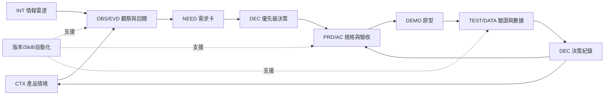

# Day 29｜把前 28 天組合成完整 AI 產品工作流


單看每一天，FlowBoard 已經有競品表、需求卡、PRD、Demo、數據結論和情報日報。若這些文件彼此沒有 ID、版本與決策關係，它們仍只是十幾份漂亮的孤島。今天要讓一個產品問題走完整條鏈。

## 串接的不是工具，而是證據與決策

完整工作流的核心問題是：上一階段的哪個輸出，會成為下一階段的哪個輸入？誰核准？如果後來發現證據錯了，能否找出受影響的需求、規格和 Demo？

因此每個產出都需要穩定識別碼、來源、版本和狀態。AI 可以轉換格式、找缺漏與建立連結候選；人要決定證據是否足以推進，以及資源要不要投入。

## FlowBoard 完整案例

以下訪談、回饋、指標、限制與結果全是教學用模擬資料。

### 1. 產品情境

Day 2 建立產品情境卡：FlowBoard 服務 10–50 人團隊；觀察到新成員加入工作區後常不知道下一步。這只是問題描述，尚未證明原因。本篇索引將它編為 `CTX-001`，方便後續交接；前篇原文並未使用此 ID。

### 2. 競品與回饋證據

Day 4–6 的截圖分析留下「頁面主行動與空白狀態」觀察。本篇索引將其編為 `OBS-003`，而不是聲稱前篇已建立此 ID。畫面可見元素是事實；「降低選擇成本」是推論。

Day 7–9 將 50 則教學用模擬回饋分群。`F03`、`F11`、`F32` 分別描述找不到同事指派任務、花時間才找到任務、以及不知道哪則通知需要處理；這些來源支持需求卡 `RC-01`，對象限於「首次登入且已有被指派工作的成員」。`F21`、`F22`、`F25`、`F46` 則支持另一張角色與權限問題卡 `RC-02`。兩組問題不能因都發生在新成員身上就合併為單一根因。

### 3. 優先級與 PRD

Day 10 以影響、急迫性、信心和成本整理候選項，人工決定先研究 `RC-01` 的「首登已有任務比例」，並比較「已有任務」與「無任務」兩種低保真開始方式。Day 11–14 的 PRD 草案定義起始提示：有任務時顯示可檢視的指派任務；沒有任務時顯示說明與聯絡管理者的建議；讀取失敗時提供重試。第一項任務排序仍是待決規則。這裡引用前篇已建立的 `FR-01`、`FR-02`、`FR-03` 與 `AC-03`，不另造 PRD 版本號。

驗收條件引用來源 ID：

```text
US-01／有任務情境（驗收草案）
Given 新成員首次進入且已有可檢視的指派任務
When 工作區首頁載入
Then 顯示起始提示與「查看第一項任務」的主要行動
Trace: FR-01, RC-01, F03, F11, F32
```

### 4. Demo 與驗證

Day 15–17 將 PRD 草案轉成 Demo 的 A（有任務）、B（無任務）、C（讀取失敗）三條路徑。教學用模擬驗收紀錄指出：`FR-01` 符合；`FR-02` 的返回狀態部分符合；`FR-03` 的無任務狀態缺少關閉入口，未符合；`AC-03` 的錯誤重試符合。原型沒有真實事件管線，因此指標事件無法判定。這是 Demo 走查結果，不能寫成正式可用性研究。

### 5. 數據與決策

Day 18–20 的教學用模擬事件資料將啟用暫定為「加入工作區後 7×24 小時內至少完成一項任務」，並以符合納入條件的邀請送達人數作分母。基準週為 `5/20＝25%`，新版週為 `8/20＝40%`，觀察差是 `+15 個百分點`。兩週各 20 人，且不是隨機實驗；因此一頁式結論只說新版週觀察值較高，暫不對外宣稱功能提升啟用率。下一步應檢查資料完整性、分群差異與其他同時變動的因素。

### 6. 情報與下一輪

Day 21–23 的教學用模擬情報卡 `FB-I-018` 記錄外部產品提供起始任務建議，但公告未提供成效。它不會推翻內部證據，只新增待查問題：「建議是否應依團隊範本變化？」Day 24–28 把摘要與日報流程版本化、封裝成 Skill，部署為每天產生待審草稿。

這條鏈不是直線終點。新情報、實驗資料或訪談會回到情境卡，更新證據信心，再決定是否修改需求與 PRD。

## 全景圖




## 可複製的交接契約

```text
artifact_id:
artifact_type:
version:
status: draft/reviewed/approved/archived
created_at:
owner:
source_ids:
confirmed_facts:
inferences:
open_questions:
decision_id:
next_artifact:
review_required_by:
```

再用以下 Prompt 找斷鏈：

```text
角色：你是產品證據鏈審查員。
輸入：【產出物索引與交接契約】
任務：檢查每項需求、規格、驗收條件與決策是否能回到來源。
限制：不補造缺少的關聯；ID 不存在就標示斷鏈；推論不得當成事實。
輸出：產出物｜來源是否完整｜狀態衝突｜過期版本｜受影響下游｜修復負責人
```

範例輸出若發現某份 Demo 引用已封存的 PRD 版本，應標成版本衝突，請 owner 決定重做或補測；AI 不自行把新版規格套進舊 Demo。

## 人類要守住的地方

第一，是否從「有證據」跨到了「值得做」，仍是策略與資源決策。第二，版本更新不能暗中改寫舊決策；應建立新版本並保留當時資訊。第三，自動化只能沿核准路徑移動資料，不能因摘要高分就建立開發承諾。

## 今天的產出物


完成 AI 產品工作流全景圖，以及一張產出物索引。最少挑一條需求，從來源一路追到 PRD、Demo、數據和決策；再反向測試來源失效時能否找到所有下游。

明天最後一次復盤，不靠「感覺變快」收尾。我們會用執行紀錄、人工修改、斷鏈與決策結果，判斷這套工作系統真正改善了什麼、還欠哪些證據。
