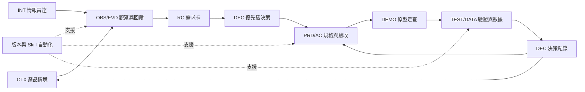

# Day 29 - 把前 28 天組合成 Claude Code 產品工作流


### 如何讓產品從最初的靈感發想到最終的決策驗證，形成環環相扣的完整鏈條？

團隊完成競品拆解、需求分析、規格書、原型展示與數據解讀後，手上會累積許多文件。

登山安全扣鏈的每個環節都有編號。看任何一環，就能追溯整條繩索通往哪座山峰。

產品文件也需要這樣一條「產品證據鏈」：用代碼、版本與交接契約，把每份產出串回它的來源與決策。

## 串接的核心在於證據與決策

串接的重點是貫穿各階段的證據與決策。每一步的產出，是下一步的輸入。每次規格調整，都能回溯到對應的用戶回饋與驗收紀錄。

一套產品工作流包含六個階段：
- **產品情境（CTX）**：地圖上的起點座標。定義團隊目標、客群與核心挑戰。
- **觀察與回饋（OBS / EVD）**：現場的錄音與照片。記錄畫面上的客觀元素與使用者反應。
- **需求卡（RC）**：採購清單。從多筆回饋提煉出使用者的核心訴求。
- **功能規格（PRD / AC）**：樂高組裝說明書。定義介面在特定條件下的狀態與驗收準則。
- **原型走查（DEMO）**：實體樣品。把抽象規格變成可操作、可驗證的路徑。
- **決策紀錄（DEC / TEST）**：實驗結案報告。根據實測數據決定下一步與迭代方向。



## 做法與權衡

原因：團隊要依專案複雜度與追溯嚴謹度，選擇跨階段資產的管理方式。

- **方案 A：輕量檔案標記法（適合敏捷小團隊）**：在 Markdown 文件頂部用 YAML 註記來源代碼與狀態，靠文字搜尋就能查關聯。
- **方案 B：系統化識別碼契約法（適合規模化協作）**：每個產出物指派全域唯一識別碼（如 CTX、OBS、RC、FR），再用 Skill 自動做跨文件雙向追溯驗證。

## FlowBoard 完整案例示範


以下展示 FlowBoard 的全流程證據串接卡片：

① **階段 1：產品情境卡片（CTX-001）**
- 聚焦對象：服務 10 至 50 人的成長型協作團隊
- 核心問題：新成員加入工作區後，常找不到下一步該做什麼
- 決策定位：專案的初始探索起點

② **階段 2：回饋與需求卡片（RC-01）**
- 支撐證據：整合回饋 F03、F11、F32
- 訴求內容：首次登入且已有指派工作的成員
- 關聯區隔：與權限管理問題卡 RC-02 分開處理

③ **階段 3：規格與驗收草案卡片（PRD-01 / US-01）**
- 驗收條件：首頁載入就呈現「查看第一項指派任務」引導
- 追溯鏈條：綁定 FR-01、RC-01 與來源回饋 F03、F11、F32
- 狀態管理：標記為待審核版本，保留審核簽章

④ **階段 4：原型走查與數據驗證卡片（DEMO / DEC-01）**
- 原型走查：完成三條路徑走查，記錄介面引導是否符合
- 數據觀察：基準週啟用率 25%，新引導版本週啟用率提升至 40%
- 決策沉澱：作為下一輪情境卡優化的實證依據


## 執行規則

① 賦予唯一代碼：每個情境、觀察、需求卡與規格條件都設定英數識別碼。
② 標註前置依據：每份規格與原型都寫明依據的需求代碼與回饋編號。
③ 實施版本鎖定：更新設計或規格就遞增版號，保留歷史版本供回溯。
④ 執行關聯稽核：定期用審核指令巡檢產出物，找出斷裂的環節。

## 結構化示範：交接契約

```text
產出物代碼：PRD-ONBOARDING-V1
產出物類型：產品規格需求書
版本序號：1.1.0
目前狀態：已審核核准（approved）
建立時間：2026-09-20
負責角色：當值產品經理
來源依據代碼：RC-01, OBS-003, CTX-001
確認客觀事實：首次登入成員中有 60% 已具備預先指派之任務
團隊核心推論：提供首要任務聚焦介面能顯著提升工作區啟用效率
待查深入問題：特定產業團隊之工作範本偏好差異
關聯決策代碼：DEC-202609-02
後續推進產出：DEMO-PATH-A
核准簽署窗口：Product Operations Lead
```

## 用 Prompt 檢查證據鏈

```text
角色：產品證據鏈審查員

輸入：
【專案各產出物索引與交接契約清單】

任務：
① 逐項檢核每項需求、規格、驗收條件與決策是否具備明確來源代碼。
② 檢查各階段文件的版本相容性與目前審核狀態。
③ 標示出任何關聯斷裂或需補齊前置依據的環節。
④ 列出受影響的下游產出物與指派負責修復窗口。

輸出：
A. 產出物追溯清單：代碼、來源完整度、版本相容狀態
B. 待補齊鏈條項目：斷裂位置、受影響產出、修復負責人
C. 決策依據總評：事實支撐程度、後續驗證建議
```

### 範例輸出與核心價值

```text
檢核項目：DEMO-PATH-C
來源依據：PRD-ONBOARDING-V1
檢核結果：發現原型仍引用早期草案規格，標示為待更新版本
處置建議：指派 Demo 負責人依據最新規格 PRD-ONBOARDING-V1.1.0 進行調整
核心價值：確保團隊在最新且經過驗證的規格上投入後續開發資源
```

這項稽核的價值是「讓每一步都有據可查」。開發不靠猜測，每行程式碼與每處設計都能追溯到真實的使用者價值。

## 人類需要檢查什麼

- 確認需求卡引用的回饋代表目標客群。
- 檢視規格書每項驗收條件都附來源代碼。
- 驗證原型符合最新審核通過的規格版本。
- 檢查數據結論有交代樣本數與環境變數。
- 發現關聯缺漏時，確認已指派專人更新。

## 把規則封裝成 Claude Code Skill

專案目錄結構配置如下：

~~~text
.claude/
├── skills/
│   ├── product-context/SKILL.md    # 產品情境分析
│   ├── feedback-cleaning/SKILL.md  # 回饋清洗與分群
│   ├── prd-review/SKILL.md         # 規格書審查
│   ├── demo-audit/SKILL.md         # 原型走查稽核
│   └── daily-intel/SKILL.md        # 每日情報整理
└── CLAUDE.md                       # 專案規範總則
docs/
├── context/                        # 產品情境資產
├── requirements/                   # 需求卡庫
├── prd/                            # 規格書存檔
├── evals/                          # 走查與驗證記錄
└── decisions/                      # 決策紀錄庫
~~~

執行指令：

~~~text
/demo-audit 請檢查本專案的產品證據鏈：從產品情境、競品觀察、回饋、需求卡、PRD、Demo、數據到情報日報，列出每一段的來源代碼與狀態。
~~~

執行後會輸出專案樹狀結構與關聯索引，列出每個產出物的上游依據與下游延伸。

## 今天的產出物


今天完成的是**AI 產品工作流全景藍圖與交接契約索引**。

工作系統的價值，是讓每個決策都能回到事實來源，每次跨階段交接都有品質標準。這套串接體系就是團隊的數位資產庫。

## 參考資料

- [Claude Code 官方文件：Extend Claude with skills](https://code.claude.com/docs/en/skills)（查閱日期：2026-09-16）
- [GOV.UK Service Manual：Agile delivery](https://www.gov.uk/service-manual/agile-delivery)（查閱日期：2026-09-15）
