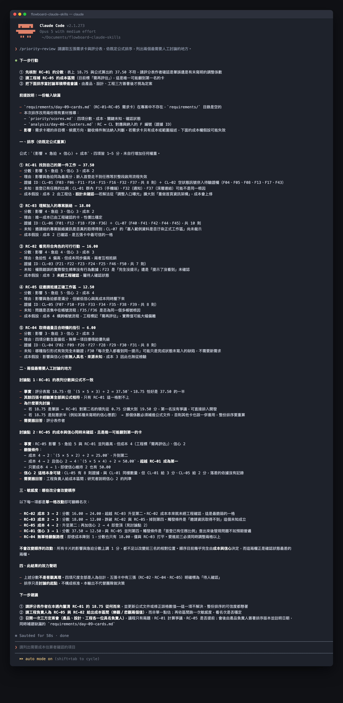

# Day 10｜用 Claude Code 整理優先級，但把決策留給人


### 面對多張同樣重要的需求卡片，團隊如何凝聚共識並決定優先投入的項目？

當團隊手中握有多張需求卡片，每位夥伴都觀察到真實的使用者痛點。這就像準備出遠門收拾背包，背包空間有限，你拿出評估清單，依據路程氣候、行進急迫性與各項裝備重量逐一衡量，挑出最關鍵的必備物品。需求優先級評估是一套結合影響力、急迫度、證據信心與開發成本的結構化評估框架，用來協助跨職能團隊排定產品探索與開發順序。

## 核心概念拆解


優先級評估的核心在於讓討論標準完全透明公開：

- **影響程度**：像放大鏡聚焦陽光產生的熱能，影響程度是問題改善後對目標行為產生的成效範圍（1–5 分）。
- **急迫性**：像路上出現的警示號誌，急迫性是問題阻斷使用者完成核心任務的嚴重程度（1–5 分）。
- **證據信心**：像地圖的清晰度與精確度，證據信心是支撐此問題之研究資料的扎實與可追溯程度（1–5 分）。
- **開發成本**：像建造橋樑所需的人力與工時，開發成本是團隊實現此功能所需投入的工程資源粗估（1–5 分，數值越高代表資源耗費越大）。

在推進優先級排序時，團隊可運用以下兩種方案進行權衡：

- **方案 A（簡單有效）：MoSCoW 分類法**。原因在於概念直觀且全員能迅速完成劃分，適合節奏緊湊且範疇單純的小型專案。
- **方案 B（高效有用）：加權量化評估公式法**。原因在於公開各項評分背後的假設與反證，適合需要多方利害關係人共同檢驗的重大產品決策。

本文採用加權評估公式作為決策討論輔助工具：

```text
初步分數 = (影響程度 × 急迫性 × 證據信心) ÷ 開發成本
```

## 執行規則

請依循以下五個動作動詞步驟執行優先級評估：

① **確立四大維度評分標準**：為影響、急迫、信心與成本設定清晰的 1–5 分量尺定義。
② **填寫需求卡評估數值**：依據現有證據賦予每張需求卡相應分數，附帶明確理由。
③ **計算初步綜合指標**：套用公式算出參考分數，標記同分與高敏感度項目。
④ **執行關鍵假設敏感度分析**：找出哪一項評分改變會直接翻轉排序結果。
⑤ **記錄團隊決策與覆核條件**：留下決策者姓名、日期與重新評估的觸發情境。

## 結構化示範：五張需求卡評估卡片

以下數值與成本皆為教學用模擬資料，轉化為五張結構化評估卡片：

① **評估卡片：RC-01 找到第一件工作**
- 評分數據：影響 5、急迫 5、信心 3、成本 2
- 初步分數：18.75
- 核心依據：F03、F11、F32 顯示成員在首登時面臨工作定位困難
- 關鍵待確認項：首登已有任務的成員比例

② **評估卡片：RC-02 呈現角色可行行動**
- 評分數據：影响 4、急迫 4、信心 3、成本 3
- 初步分數：16.00
- 核心依據：F21、F22、F25 顯示一般成員點擊後才得知權限界線
- 關鍵待確認項：權限受限發生的實際頻率

③ **評估卡片：RC-03 理解專案脈絡**
- 評分數據：影響 4、急迫 3、信心 3、成本 2
- 初步分數：18.00
- 核心依據：F01、F07、F18 顯示專案名稱縮寫與背景資訊待補齊
- 關鍵待確認項：邀請資訊的可取得性

④ **評估卡片：RC-04 提供合時機指引**
- 評分數據：影響 3、急迫 3、信心 2、成本 3
- 初步分數：6.00
- 核心依據：F02、F26 顯示過長指引常被直接關閉
- 關鍵待確認項：哪種引導演練形式最具實效

⑤ **評估卡片：RC-05 從邀請抵達工作區**
- 評分數據：影響 5、急迫 5、信心 2、成本 4
- 初步分數：12.50
- 核心依據：F34、F35、F36 顯示跨工作區與帳號切換存在落差
- 關鍵待確認項：問題是否高度集中於特定單一登入流程

## 提示詞設計（Prompt）

```text
背景：
FlowBoard 團隊具備五張新成員啟用需求卡，兩週內安排一項概念驗證。

任務：
① 依據需求卡內容，檢查每項評分的證據支持度。
② 依指定公式精確計算各需求卡得分，保持數值原樣。
③ 找出可能翻轉排序的關鍵假設與敏感變數。
④ 提出「優先研究」與「概念驗證」的建議方案組合。

輸入：
【需求卡全文】
【評估評分指標】

規則：
① 嚴格遵循既定評分公式進行複核。
② 每項評分皆需關聯卡片中的具體事實。
③ 明確標示同分與分數接近之項目。
④ 將量化指標視為討論材料，將最終決策權留給團隊。

輸出：
A. 數值計算複核清單
B. 各卡片支持理由與潛在反證
C. 關鍵假設敏感度分析
D. 跨職能討論建議議程
```

## 範例輸出與核心價值

```text
排序候選焦點：RC-01 找到第一件工作
支持依據：F03、F11、F32 呈現任務尋找的具體困擾。
反證考量：若真實數據顯示多數成員首登時尚待指派任務，影響分數將調整至 2 分。
敏感度提醒：此數值變動將使 RC-01 與 RC-03 順序對調。
建議行動：優先調閱登入事件資料，確認分流比例後再推進概念原型。
```

這套優先級評估的核心價值在於：促使團隊看見分數背後的假設，讓決策依據透明化，把寶貴的工程時間投資在最值得驗證的機會上。

## 人類需要檢查什麼

請團隊在會議中逐一核對以下四個驗證問題：

① 各項評分是否有需求卡中的客觀證據支持？
② 哪一個關鍵假設發生變化時會翻轉排序結果？
③ 評分差異是否來自不同角色對使用者情境的不同理解？
④ 團隊是否明確設定觸發重新評審的數據條件？

## 把規則封裝成 Claude Code Skill

建立 `.claude/skills/priority-review/SKILL.md`：

~~~markdown
---
name: priority-review
description: 根據指定維度整理需求優先級，呈現場景理由、待確認項與敏感度分析。
---

請依循以下步驟執行分析：
① 嚴格運用輸入提供的評分量尺，維持權重標準。
② 詳列每個分數的依據、證據 ID 與成本假設。
③ 輸出排序結果後，具體說明關鍵數值調整對順序的影響。
④ 提示團隊核心成員共同確認，保持人工決策主權。
~~~

執行指令：

~~~text
/priority-review 請讀取五張需求卡與評分表，依既定公式排序，列出兩個最需要人工討論的地方。
~~~

執行後，終端機完整列出計算公式、各項輸入分數與待討論事項：



截圖清楚顯示公式推導過程與待確認清單，確保團隊始終掌握產品決策的主導權。

## 今天的產出物


今天帶走的核心重點是一套**需求優先級評估結構**：
- 運用影響、急迫、信心與成本四維度建立客觀對齊語言。
- 透過敏感度分析預先洞察關鍵假設對決策的影響。
- 建立具備覆核條件的決策留痕紀錄，支持敏捷迭代。

## 參考資料

- [Atlassian：Six product prioritization frameworks and how to pick the right one](https://www.atlassian.com/agile/product-management/prioritization-framework)
